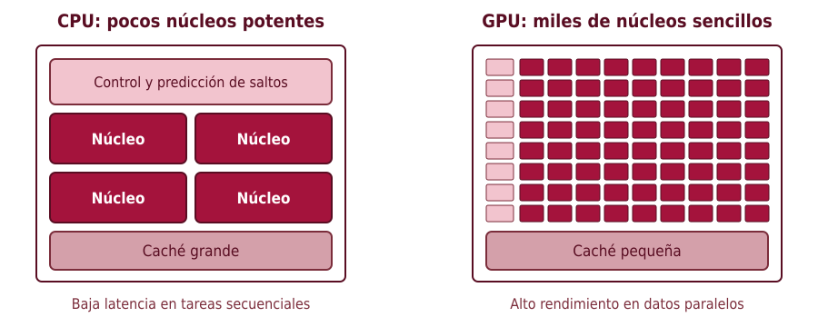
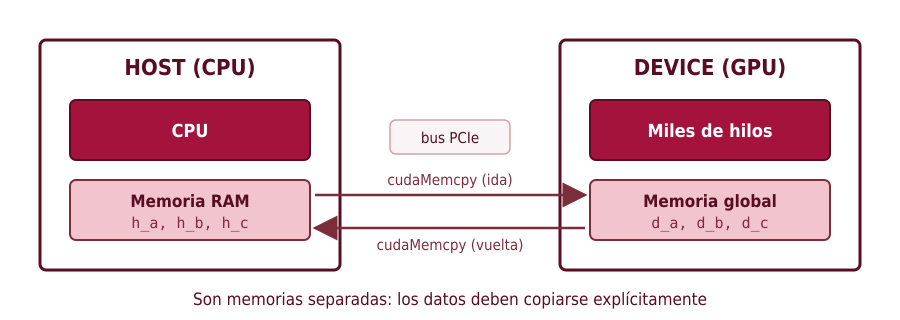
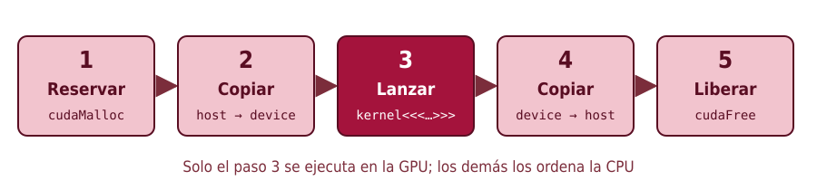
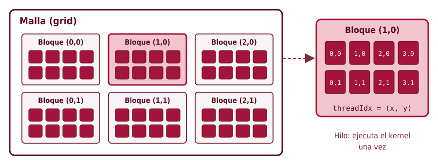
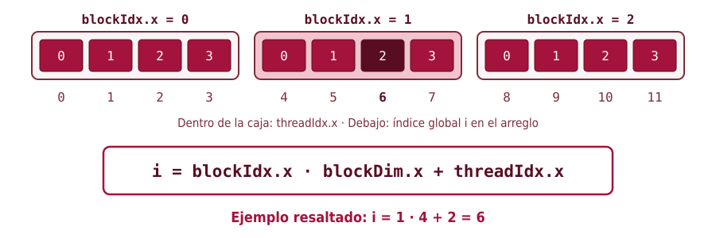
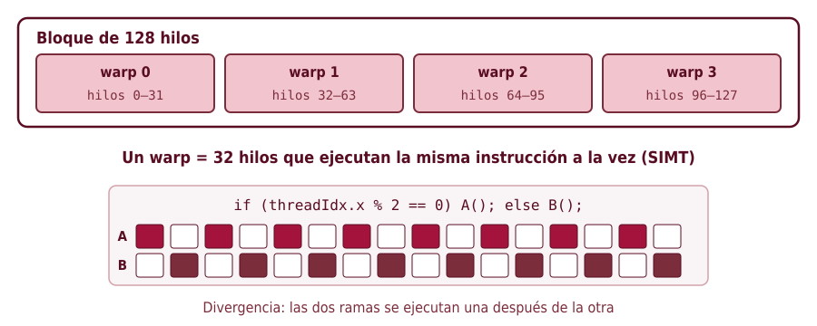
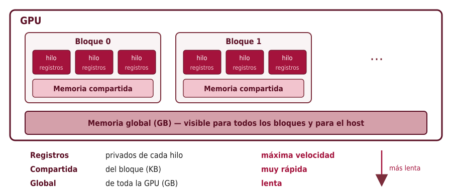

<!-- _class: portada -->
<!-- _paginate: false -->

# Conceptos básicos de CUDA

## Cómo pensar un programa para la GPU

Universidad Industrial de Santander
Escuela de Ingeniería de Sistemas e Informática

<!--
Bienvenida. El objetivo de esta sesión es corta y concreta: que al final cada estudiante pueda leer un programa CUDA sencillo y explicar qué hace cada parte. No se busca optimizar todavía; se busca entender el modelo.
-->

---

# Agenda

1. **¿Por qué una GPU?**
2. **Host y device**: dos computadores en uno
3. **Kernels** y la jerarquía de hilos
4. **El índice global**: a cada hilo, su dato
5. **Warps y memoria**: lo que conviene saber desde el principio
6. Síntesis

<!--
Se presenta el recorrido. Son cinco ideas; si los estudiantes se llevan estas cinco, pueden entender casi cualquier ejemplo introductorio de CUDA, ya sea en C, en CUDA Python o en Numba.
-->

---

<!-- _class: seccion -->

# 1. ¿Por qué una GPU?

Muchos núcleos sencillos en lugar de pocos núcleos complejos

<!--
Primera idea: la GPU no es una CPU más rápida, es una máquina diseñada con otro propósito.
-->

---

# CPU y GPU: dos filosofías



> La GPU gana cuando hay **la misma operación sobre muchísimos datos** independientes.

<!--
La CPU dedica mucho espacio del chip a control y caché para que un solo hilo vaya lo más rápido posible. La GPU dedica ese espacio a unidades de cálculo: cada una es más lenta, pero hay miles.

Pregunta para el grupo: ¿qué problemas de su carrera tienen "la misma operación sobre muchos datos"? Respuestas esperadas: operaciones con matrices, simulaciones de partículas, procesamiento de imágenes, Montecarlo.
-->

---

<!-- _class: seccion -->

# 2. Host y device

La CPU dirige; la GPU calcula

<!--
Segunda idea: un programa CUDA siempre tiene dos actores.
-->

---

# Dos procesadores, dos memorias



- **Host**: la CPU y su memoria RAM. Allí empieza y termina el programa.
- **Device**: la GPU y su memoria propia.
- Convención útil: prefijo `h_` para datos del host y `d_` para datos del device.

<!--
Este es el error conceptual más frecuente al empezar: creer que la GPU puede leer directamente las variables del programa. No puede; la memoria es distinta y los datos viajan por el bus PCIe, que es relativamente lento. Por eso conviene copiar pocas veces y calcular mucho en la GPU.
-->

---

# El flujo de todo programa CUDA



```c
cudaMalloc(&d_x, bytes);                               // 1
cudaMemcpy(d_x, h_x, bytes, cudaMemcpyHostToDevice);   // 2
mi_kernel<<<bloques, hilos>>>(d_x, n);                 // 3
cudaMemcpy(h_x, d_x, bytes, cudaMemcpyDeviceToHost);   // 4
cudaFree(d_x);                                         // 5
```

<!--
Estos cinco pasos aparecen en todos los ejemplos del curso. Cuando lean un programa nuevo, conviene buscarlos primero: así identifican rápidamente qué es preparación y qué es cálculo.

Detalle: el lanzamiento del kernel es asíncrono; la CPU no espera. La copia del paso 4 sí espera a que el kernel termine, por eso el resultado llega correcto.
-->

---

<!-- _class: seccion -->

# 3. Kernels e hilos

Una función que se ejecuta miles de veces a la vez

<!--
Tercera idea: el kernel.
-->

---

# ¿Qué es un kernel?

Una función marcada con `__global__`: se **llama desde la CPU** y se **ejecuta en la GPU**.

```c
__global__ void duplicar(float *x, int n)
{
    int i = blockIdx.x * blockDim.x + threadIdx.x;   // ¿quién soy?
    if (i < n)                                       // ¿me toca trabajar?
        x[i] = 2.0f * x[i];                          // mi parte del trabajo
}
```

Lanzamiento: `duplicar<<<bloques, hilos_por_bloque>>>(d_x, n);`

> No hay ciclo `for`: **cada hilo procesa un elemento**. El ciclo lo "reemplaza" la cantidad de hilos.

<!--
Comparar con la versión secuencial: for (i = 0; i < n; i++) x[i] = 2*x[i]. En CUDA desaparece el for; en su lugar se lanzan n hilos y cada uno hace una iteración.

Las tres líneas del kernel responden tres preguntas que se repiten siempre: quién soy, si me toca trabajar y qué hago.
-->

---

# La jerarquía: malla → bloques → hilos



- Los hilos se agrupan en **bloques** (hasta 1024 hilos por bloque).
- Los bloques forman una **malla** (*grid*).
- Cada hilo conoce su posición: `threadIdx`, `blockIdx`, `blockDim`, `gridDim`.

<!--
La razón de tener bloques: los hilos de un mismo bloque pueden cooperar (compartir memoria y sincronizarse); los de bloques distintos no. Además, la GPU reparte los bloques entre sus multiprocesadores, lo que permite que el mismo programa funcione en GPU pequeñas y grandes.

Las coordenadas pueden ser 1D, 2D o 3D. Para vectores se usa 1D; para matrices, 2D.
-->

---

<!-- _class: seccion -->

# 4. El índice global

A cada hilo, su dato

<!--
Cuarta idea, y la más importante para programar: cómo cada hilo sabe qué elemento le corresponde.
-->

---

# ¿Qué elemento le toca a cada hilo?



<!--
Hacer el cálculo en voz alta con el hilo resaltado: está en el bloque 1, cada bloque tiene 4 hilos, y es el hilo 2 dentro de su bloque. Entonces le corresponde el elemento 1·4 + 2 = 6.

Ejercicio rápido: ¿qué elemento procesa el hilo 3 del bloque 2? Respuesta: 2·4 + 3 = 11.
-->

---

# ¿Cuántos bloques lanzar?

Si `n = 1000` y usamos 256 hilos por bloque:

$$\text{bloques} = \left\lceil \frac{1000}{256} \right\rceil = 4 \quad\Rightarrow\quad 4 \times 256 = 1024 \text{ hilos}$$

```c
int hilos   = 256;
int bloques = (n + hilos - 1) / hilos;   // división entera redondeando hacia arriba
```

> Sobran 24 hilos: por eso el kernel lleva `if (i < n)`. **Sin esa condición, se escribe fuera del arreglo.**

<!--
Este es el segundo error más común: olvidar la condición de borde. El programa puede incluso funcionar en algunas ejecuciones y fallar en otras, lo que lo hace difícil de depurar.

El truco (n + hilos - 1) / hilos es la forma habitual de redondear hacia arriba con enteros.
-->

---

# En dos dimensiones: matrices

```c
dim3 hilos(16, 16);                                   // 256 hilos por bloque
dim3 bloques((N + 15) / 16, (N + 15) / 16);
matmul<<<bloques, hilos>>>(d_A, d_B, d_C, N);
```

Dentro del kernel:

```c
int fila = blockIdx.y * blockDim.y + threadIdx.y;
int col  = blockIdx.x * blockDim.x + threadIdx.x;
if (fila < N && col < N) { /* calcular C[fila][col] */ }
```

> Es la misma idea, repetida en cada eje: **un hilo por elemento de la matriz**.

<!--
Conectar con el ejemplo de multiplicación de matrices que se trabajará en el taller. Se recomienda que x corresponda a las columnas: así hilos vecinos leen posiciones vecinas de memoria, lo cual es más eficiente (se verá con más detalle en la sección de memoria).
-->

---

<!-- _class: seccion -->

# 5. Warps y memoria

Dos detalles que afectan el rendimiento

<!--
Quinta idea: dos aspectos del hardware que conviene conocer desde el principio, aunque todavía no se optimice.
-->

---

# Warps: los hilos avanzan en grupos de 32



<!--
La GPU no ejecuta hilos sueltos: los agrupa de a 32 (un warp) y les da la misma instrucción. Si dentro de un warp hay un if que separa a los hilos, la GPU ejecuta primero una rama y luego la otra, con la mitad de los hilos inactivos en cada una.

Consecuencias prácticas: usar tamaños de bloque múltiplos de 32 (128, 256) y evitar condicionales que dependan del número de hilo cuando sea posible.
-->

---

# Jerarquía de memoria de la GPU



<!--
Por ahora basta saber que existen tres niveles. Las variables locales del kernel viven en registros; los arreglos que se pasan con cudaMalloc viven en memoria global. La memoria compartida se declara con __shared__ y la usan los hilos de un mismo bloque para cooperar; se usará más adelante, por ejemplo para acelerar la multiplicación de matrices por bloques (tiling).
-->

---

# El mismo kernel en Python (Numba)

```python
from numba import cuda

@cuda.jit
def duplicar(x):
    i = cuda.grid(1)          # = blockIdx.x * blockDim.x + threadIdx.x
    if i < x.size:
        x[i] = 2.0 * x[i]

d_x = cuda.to_device(h_x)                       # copiar host → device
duplicar[bloques, hilos](d_x)                   # lanzar
h_x = d_x.copy_to_host()                        # copiar device → host
```

> Cambia la sintaxis, **no cambian los conceptos**: índice global, condición de borde, copias.

<!--
Se muestra que todo lo visto se traslada directamente. Numba se encarga de reservar y liberar memoria, pero las copias entre host y device siguen existiendo (y siguen costando). cuda.grid(1) es solo un atajo para el cálculo del índice global.
-->

---

# Errores frecuentes al empezar

| Error | Consecuencia |
|---|---|
| Olvidar `if (i < n)` | Escritura fuera del arreglo |
| Usar un puntero del host dentro del kernel | Fallo o resultados basura |
| Copiar datos en cada paso de un ciclo | El programa es más lento que en CPU |
| Más de 1024 hilos por bloque | El kernel no se lanza (sin detener el programa) |
| No revisar errores | Fallos silenciosos |

```c
cudaError_t err = cudaGetLastError();
if (err != cudaSuccess) printf("Error: %s\n", cudaGetErrorString(err));
```

<!--
Insistir en el último punto: un kernel mal lanzado no detiene el programa; simplemente no hace nada y los resultados quedan en cero o con basura. Revisar cudaGetLastError después de cada lanzamiento ahorra mucho tiempo de depuración.
-->

---

# Síntesis

1. La GPU sirve para aplicar **la misma operación a muchos datos**.
2. **Host y device tienen memorias separadas**: hay que copiar.
3. Un **kernel** se ejecuta una vez por hilo; los hilos se organizan en **bloques** y **mallas**.
4. `i = blockIdx.x * blockDim.x + threadIdx.x` y **siempre** `if (i < n)`.
5. Los hilos avanzan en **warps de 32**; la memoria tiene **niveles** con velocidades muy distintas.

<!--
Repasar las cinco ideas. Como cierre, se sugiere pasar directamente a los ejemplos de multiplicación de matrices y de integración por Montecarlo, y pedir a los estudiantes que identifiquen en ellos los cinco pasos del flujo y el cálculo del índice global.
-->
