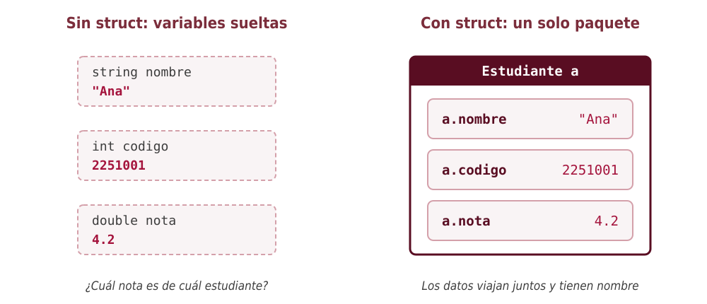
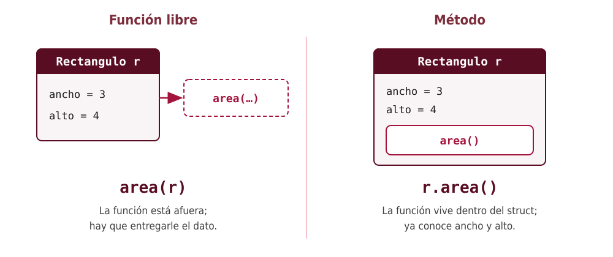
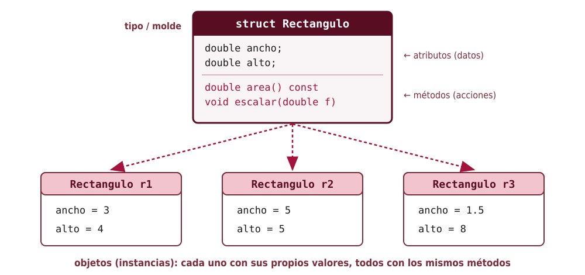
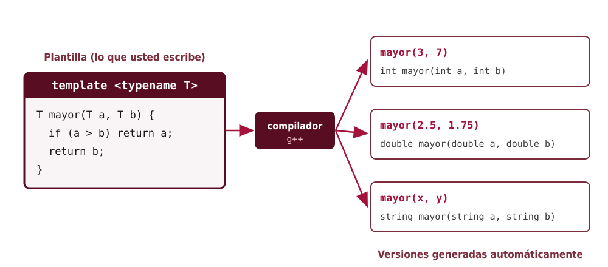
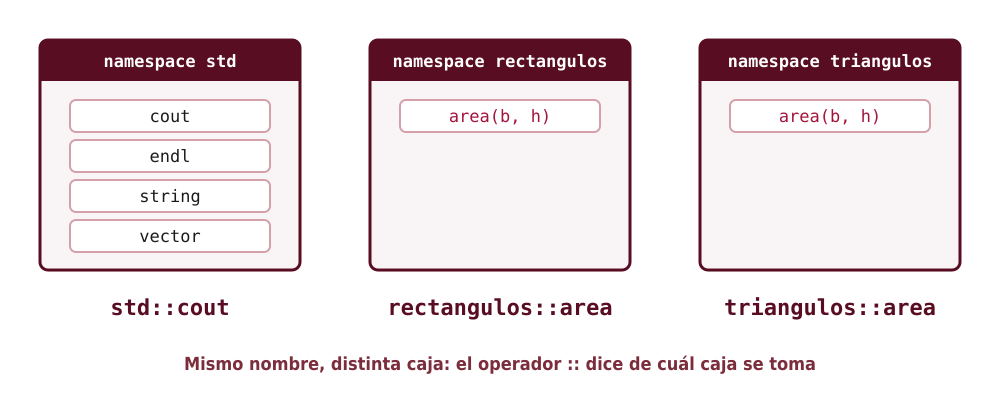

<!-- _class: portada -->
<!-- _paginate: false -->

# De los structs a los objetos

## Structs, métodos, templates y namespaces en C++

Fundamentos de Programación
Escuela de Ingeniería de Sistemas e Informática
Universidad Industrial de Santander

<!--
Bienvenida. Hasta ahora se ha trabajado con funciones, arreglos tipo C y vector<>. Hoy se da el primer paso hacia la programación orientada a objetos, pero de forma deliberadamente simple: partiendo del struct de toda la vida y agregándole funciones adentro. Al final se presentan dos herramientas que los estudiantes ya han usado sin saberlo: los templates (vector<int>) y los namespaces (std::).
-->

---

# Agenda

1. **Structs**: agrupar datos que van juntos
2. **Métodos**: funciones que viven dentro del struct
3. **Templates**: una sola definición para muchos tipos
4. **Namespaces**: apellidos para los nombres
5. Ejemplo integrador, errores comunes y ejercicios

> Hoy **no** se verá herencia, polimorfismo ni encapsulamiento con `private`. Eso llegará más adelante.

<!--
Conviene dejar claro el alcance desde el principio. La sesión es una introducción: la idea central es que un objeto es "datos + funciones que trabajan sobre esos datos". Lo demás (clases con private, constructores, herencia, polimorfismo) se construye encima de esa idea y queda para cursos posteriores.

Tiempo sugerido: unas dos horas, con una pausa natural antes de la sección de templates.
-->

---

<!-- _class: seccion -->

# 1. Structs

Cuando varios datos describen una misma cosa

<!--
Se arranca con un problema concreto que los estudiantes pueden reconocer: manejar los datos de varios estudiantes con lo que ya saben (variables y arreglos).
-->

---

# El problema: datos que van juntos

Se quiere guardar el nombre, el código y la nota de **un** estudiante:

```cpp
string nombre = "Ana";
int codigo = 2251001;
double nota = 4.2;
```

¿Y para 40 estudiantes? Con lo visto hasta ahora habría que usar **tres arreglos paralelos**:

```cpp
vector<string> nombres;
vector<int> codigos;
vector<double> notas;
// nombres[i], codigos[i] y notas[i] "deberían" ser del mismo estudiante...
```

<!--
Pregunte al grupo: ¿qué pasa si se ordena el vector de notas para sacar el mejor puntaje? Los otros dos vectores no se ordenan solos, y la correspondencia se pierde. ¿Y si se borra un estudiante? Hay que acordarse de borrarlo de los tres vectores.

El problema de fondo es que el programa no sabe que esos tres datos forman una unidad: eso solo está en la cabeza del programador.
-->

---

# La idea: un solo paquete



<!--
El struct le dice al compilador: "estos datos forman una sola cosa". A la izquierda, tres variables sin relación entre sí; a la derecha, una variable `a` que contiene tres campos con nombre.

Énfasis: el struct es un tipo de dato nuevo creado por el programador, igual que int o double, pero compuesto.
-->

---

# Definir un struct

```cpp
struct Estudiante {
    string nombre;
    int codigo;
    double nota;
};   // ← ¡el punto y coma es obligatorio!
```

- `struct Estudiante` crea un **tipo nuevo** llamado `Estudiante`
- `nombre`, `codigo` y `nota` son sus **campos** (o **atributos**)
- La definición va **fuera** de `main`, normalmente al inicio del archivo
- Por convención, el nombre del tipo empieza con **mayúscula**

<!--
Definir el struct no crea ninguna variable: solo describe la forma. Es como dibujar el formulario vacío; todavía no se ha llenado ninguno.

El punto y coma final es el error número uno de la clase. Si se olvida, g++ responde: "expected ';' after struct definition". Vale la pena mostrarlo en vivo.
-->

---

# Crear variables y usar el operador punto

```cpp
Estudiante a;              // una variable de tipo Estudiante
a.nombre = "Ana";          // el punto entra a un campo
a.codigo = 2251001;
a.nota = 4.2;

Estudiante b{"Luis", 2251002, 3.4};   // inicialización con llaves

cout << b.nombre << " tiene " << b.nota << endl;
```

- `variable.campo` se usa exactamente como una variable normal
- Con llaves `{}` los valores se asignan **en el orden** en que se declararon los campos

<!--
El operador punto es el protagonista de toda la sesión: aquí sirve para llegar a un dato; en la siguiente sección servirá para llamar una función.

Advertencia: `Estudiante a;` deja los campos numéricos con basura (igual que `int x;`). La inicialización con llaves evita ese problema y es la forma recomendada.
-->

---

# Structs y funciones

```cpp
// Referencia constante: no copia y no modifica
void imprimir(const Estudiante &e) {
    cout << e.codigo << "  " << e.nombre << "  " << e.nota << endl;
}

// Referencia: sí modifica el original
void bonificar(Estudiante &e, double puntos) {
    e.nota = e.nota + puntos;
    if (e.nota > 5.0) {
        e.nota = 5.0;
    }
}
```

Las reglas de paso de parámetros son **las mismas** que ya conocen.

<!--
Repaso rápido del paso por valor y por referencia, ahora con structs. Un struct puede ser grande (imagine uno con un vector de mil notas), así que se acostumbra pasarlo por referencia constante cuando la función solo lee.

Si se pasara por valor a bonificar, la función modificaría una copia y el cambio se perdería. Es un buen momento para preguntar: ¿qué imprimiría el programa si se quita el & de bonificar?
-->

---

# Un vector de structs

```cpp
vector<Estudiante> grupo;
grupo.push_back({"Ana", 2251001, 4.2});
grupo.push_back({"Luis", 2251002, 3.4});
grupo.push_back({"Marta", 2251003, 4.7});

bonificar(grupo[1], 0.3);

double suma = 0.0;
for (const Estudiante &e : grupo) {
    suma += e.nota;
}
cout << "Promedio: " << suma / grupo.size() << endl;   // 4.2
```

Ahora cada elemento del vector es **un estudiante completo**: ya no hay arreglos paralelos.

<!--
Este es el cierre de la primera sección: se resolvió el problema inicial. Si se ordena el vector, cada estudiante se mueve con todos sus datos.

`grupo[1].nota` combina las dos notaciones: corchetes para elegir el elemento y punto para elegir el campo.

Salida real del programa completo (ejemplos/01_structs.cpp): Luis queda con 3.7 y el promedio es 4.2.
-->

---

<!-- _class: seccion -->

# 2. Métodos

Funciones que viven dentro del struct

<!--
Aquí está el salto conceptual de la sesión. Se recomienda ir despacio y apoyarse en algo que los estudiantes ya hacen todos los días: v.size() y v.push_back().
-->

---

# Ustedes ya han usado métodos

```cpp
vector<int> v{4, 8, 15};
v.push_back(16);
cout << v.size() << endl;

string s = "hola";
cout << s.length() << endl;
```

- `push_back`, `size` y `length` **no** se llaman así: `size(v)`
- Se llaman **sobre** la variable: `v.size()`
- Son **funciones que pertenecen al dato**: eso es un **método**

<!--
Pregunta para el grupo: ¿por qué se escribe v.size() y no size(v)? La respuesta corta de hoy: porque size es una función que vive dentro del tipo vector. Cada vector "sabe" cuántos elementos tiene.

A partir de este momento, los estudiantes van a poder escribir sus propios tipos que funcionen de la misma manera.
-->

---

# Función libre vs. método



<!--
A la izquierda, el estilo de la sección anterior: una función externa que recibe el struct como parámetro. A la derecha, la función se mete dentro del struct; ya no necesita recibirlo, porque trabaja directamente con los campos del objeto sobre el que se llama.

Las dos versiones calculan lo mismo. La diferencia es de organización: en la versión con método, los datos y las operaciones sobre esos datos están en el mismo lugar.
-->

---

# El primer método

```cpp
struct Rectangulo {
    double ancho;
    double alto;

    double area() {
        return ancho * alto;     // usa los campos directamente
    }
};

int main() {
    Rectangulo r{3.0, 4.0};
    cout << r.area() << endl;    // 12
}
```

- El método se escribe **dentro** de las llaves del struct
- Dentro del método, `ancho` y `alto` son los campos **del objeto que lo llamó**

<!--
Señale la línea `return ancho * alto;`: no hay ningún parámetro y aun así el método sabe de qué rectángulo se trata. Eso es porque se llamó como r.area(): el objeto r está "a la izquierda del punto" y es el dueño de esos campos.

Si se tuvieran r1 y r2, r1.area() usa el ancho y alto de r1, y r2.area() los de r2.
-->

---

# Comparación lado a lado

**Con función libre**

```cpp
double area(const Rectangulo &r) {
    return r.ancho * r.alto;
}
cout << area(r) << endl;
```

**Con método**

```cpp
struct Rectangulo {
    double ancho;
    double alto;
    double area() { return ancho * alto; }
};
cout << r.area() << endl;
```

<!--
Puntos a destacar:
1. El parámetro desaparece: el objeto viene "implícito" a la izquierda del punto.
2. Dentro del método ya no se escribe r.ancho sino solo ancho.
3. La llamada cambia de area(r) a r.area().

Ninguna de las dos formas es incorrecta. Pero cuando un tipo tiene muchas operaciones, tenerlas dentro del struct hace que el código sea más fácil de encontrar y de leer.
-->

---

# Métodos que modifican el objeto

```cpp
struct Rectangulo {
    double ancho;
    double alto;

    double area() { return ancho * alto; }

    void escalar(double factor) {
        ancho = ancho * factor;
        alto = alto * factor;
    }
};

Rectangulo r{3.0, 4.0};
r.escalar(2.0);
cout << r.ancho << " x " << r.alto << endl;   // 6 x 8
cout << r.area() << endl;                       // 48
```

<!--
Un método puede recibir parámetros adicionales (aquí, factor) y puede cambiar los campos del objeto. No hace falta ningún & : el método trabaja sobre el objeto original, no sobre una copia.

Compárelo con la función bonificar de la sección anterior, que necesitaba Estudiante &e para poder modificar. Con un método eso viene incluido.
-->

---

# Métodos `const`: "solo miro, no toco"

```cpp
struct Rectangulo {
    double ancho;
    double alto;

    double area() const {          // promete no modificar el objeto
        return ancho * alto;
    }

    void escalar(double factor) {  // modifica: no lleva const
        ancho = ancho * factor;
        alto = alto * factor;
    }
};
```

- Se pone `const` **después** de los paréntesis en los métodos que solo consultan
- Si un método `const` intenta modificar un campo, el compilador da **error**

<!--
Esta es la única "regla extra" que se introduce hoy, y se justifica por algo práctico: si un objeto se recibe como const Rectangulo &r, solo se le pueden llamar métodos const. Sin esa palabra, imprimir(const Rectangulo &r) no podría llamar r.area().

Regla simple para los estudiantes: si el método no cambia ningún campo, póngale const.

Error real si se intenta modificar: "assignment of member 'Rectangulo::ancho' in read-only object".
-->

---

# Un método puede usar otro método

```cpp
struct Estudiante {
    string nombre;
    vector<double> notas;

    void agregarNota(double n) { notas.push_back(n); }

    double promedio() const {
        if (notas.empty()) return 0.0;
        double suma = 0.0;
        for (double n : notas) suma += n;
        return suma / notas.size();
    }

    bool aprobo() const { return promedio() >= 3.0; }
};
```

```cpp
Estudiante e{"Ana", {}};
e.agregarNota(3.5);  e.agregarNota(4.0);  e.agregarNota(2.8);
cout << e.promedio() << " " << e.aprobo() << endl;   // 3.43333 1
```

<!--
Este ejemplo junta todo lo visto: un campo que es un vector, un método que lo modifica (agregarNota), un método que calcula (promedio) y un método que usa a otro (aprobo llama a promedio sin escribir ningún objeto delante, porque es el mismo objeto).

`{}` en la inicialización deja el vector de notas vacío.

Note que agregarNota llama a push_back: un método propio que usa un método de vector. Los objetos se construyen a partir de otros objetos.
-->

---

# Vocabulario: tipo y objetos



<!--
Aquí se introduce el vocabulario de la programación orientada a objetos, sin más teoría:
- El struct es el molde o tipo (en otros lenguajes y más adelante: la clase).
- Cada variable creada con ese molde es un objeto o instancia.
- Los campos se llaman atributos; las funciones internas, métodos.

Cada objeto tiene sus propios valores de ancho y alto, pero todos comparten el mismo código de los métodos.
-->

---

# En resumen: un objeto es...

| Término | Qué es | Ejemplo |
|---|---|---|
| **Tipo** (struct / clase) | El molde | `Rectangulo` |
| **Objeto** (instancia) | Una variable de ese tipo | `r1`, `r2` |
| **Atributo** (campo) | Un dato dentro del objeto | `r1.ancho` |
| **Método** | Una función dentro del objeto | `r1.area()` |

> **Objeto = datos + las funciones que trabajan sobre esos datos**

<!--
Esta tabla es la idea que deben llevarse de la primera mitad. Si quedan con eso claro, el resto de la programación orientada a objetos (encapsulamiento, herencia, polimorfismo) son refinamientos de esta misma idea.

Comentario opcional: en C++ struct y class son casi lo mismo; la única diferencia es quién puede ver los atributos por defecto. Eso se estudiará cuando se vea private.

Buen momento para la pausa.
-->

---

<!-- _class: seccion -->

# 3. Templates

Una sola definición para muchos tipos

<!--
Se retoma después de la pausa. La pregunta que motiva la sección: ¿por qué se escribe vector<int> con esos ángulos? Al final de la sección los estudiantes podrán escribir sus propias funciones y structs con ángulos.
-->

---

# El problema: el mismo código, tipos distintos

```cpp
int mayor(int a, int b) {
    if (a > b) return a;
    return b;
}

double mayor(double a, double b) {
    if (a > b) return a;
    return b;
}

string mayor(string a, string b) {
    if (a > b) return a;
    return b;
}
```

Tres funciones **idénticas**; solo cambia el tipo. ¿Y si mañana se necesita para `char`?

<!--
Muestre que el cuerpo es exactamente el mismo en las tres. Copiar y pegar código es una fuente clásica de errores: si se encuentra un error en una versión, hay que corregirlo en todas.

Lo que se necesita es poder escribir "el tipo T, sea cual sea".
-->

---

# La solución: un template de función

```cpp
template <typename T>
T mayor(T a, T b) {
    if (a > b) return a;
    return b;
}

int main() {
    cout << mayor(3, 7) << endl;        // T = int     → 7
    cout << mayor(2.5, 1.75) << endl;   // T = double  → 2.5

    string x = "perro", y = "gato";
    cout << mayor(x, y) << endl;        // T = string  → perro
}
```

- `template <typename T>` dice: "`T` es un tipo que se decide después"
- Dentro de la función, `T` se usa como cualquier otro tipo

<!--
T es solo un nombre (se podría llamar Tipo o Dato), pero por costumbre se usa T.

El compilador deduce T mirando los argumentos: con 3 y 7 deduce int; con 2.5 y 1.75 deduce double.

Observación para el profesor: si se escribe mayor("perro", "gato") con literales directamente, T se deduce como const char* y se comparan direcciones de memoria, no texto. Por eso el ejemplo usa variables string. No es necesario entrar en ese detalle con el grupo, salvo que alguien lo pruebe.
-->

---

# ¿Qué hace el compilador?



<!--
Un template no es una función: es una receta para fabricar funciones. Cuando el compilador ve mayor(3, 7), toma la plantilla, reemplaza T por int y genera la versión int. Lo mismo para cada tipo que se use.

Consecuencia importante: todo esto ocurre al compilar, no al ejecutar. El programa final tiene las tres versiones como si se hubieran escrito a mano, sin costo extra de velocidad.
-->

---

# Ustedes ya usan templates: `vector<T>`

```cpp
vector<int> enteros{1, 2, 3, 4};
vector<double> reales{0.5, 0.25, 0.25};
vector<string> palabras{"hola", " ", "mundo"};
```

`vector` **no** es un tipo: es una **plantilla**. Los ángulos `< >` le dicen qué tipo usar.

```cpp
template <typename T>
T sumar(const vector<T> &v) {
    T total{};                 // el "cero" del tipo T
    for (const T &x : v) {
        total += x;
    }
    return total;
}
// sumar(enteros) → 10   sumar(reales) → 1   sumar(palabras) → "hola mundo"
```

<!--
Este es el momento "ajá" de la sección: lo que han escrito desde que vieron vector<int> es exactamente el uso de un template. Alguien escribió vector una sola vez con template <typename T>, y funciona para cualquier tipo.

`T total{}` inicializa con el valor por defecto del tipo: 0 para int, 0.0 para double, cadena vacía para string. Por eso la misma función suma números y concatena textos.
-->

---

# Templates de struct

```cpp
template <typename T>
struct Par {
    T primero;
    T segundo;

    T elMayor() const {
        return mayor(primero, segundo);   // usa el template anterior
    }
};

int main() {
    Par<int> p{3, 8};
    Par<string> n{"Ana", "Luis"};
    cout << p.elMayor() << " " << n.elMayor() << endl;   // 8 Luis
}
```

Con structs el tipo se escribe **explícitamente** entre ángulos: `Par<int>`, como en `vector<int>`.

<!--
Un struct también puede ser plantilla. Se escribe la línea template <typename T> justo antes del struct y se usa T en los campos y métodos.

Con funciones, el compilador suele deducir T solo. Con structs hay que decirlo: Par<int>, Par<string>. Es exactamente lo mismo que hacen al escribir vector<int>.
-->

---

# Cuidados con los templates

```cpp
mayor(3, 2.5);   // ERROR: ¿T es int o double?
```

> error: no matching function for call to 'mayor(int, double)'

- Los dos argumentos deben ser del **mismo tipo** `T`
- Solución: indicar el tipo a mano → `mayor<double>(3, 2.5)`

&nbsp;

- `T` debe **soportar** las operaciones que se usan dentro: `mayor` usa `>`, así que no sirve con un `Rectangulo` (no se sabe cuál es "mayor")
- El error aparece **al compilar**, en la línea donde se usa el template

<!--
Dos errores típicos:
1. Mezclar tipos: con 3 (int) y 2.5 (double) el compilador no sabe qué T elegir. Se resuelve escribiendo el tipo entre ángulos.
2. Usar un tipo que no tiene la operación necesaria. Si se llama mayor con dos Rectangulo, falla porque no se ha definido qué significa r1 > r2. Los mensajes de error de templates suelen ser largos; recomiende a los estudiantes buscar la primera línea que dice "error" y la línea de su propio código.
-->

---

<!-- _class: seccion -->

# 4. Namespaces

Apellidos para los nombres

<!--
Última herramienta del día. De nuevo se parte de algo que los estudiantes ya escriben sin entender del todo: using namespace std; y std::cout.
-->

---

# El problema: nombres que chocan

En un programa grande, dos personas escriben una función `area`:

```cpp
// Escrita por la persona A: área de un rectángulo
double area(double base, double altura) {
    return base * altura;
}

// Escrita por la persona B: área de un triángulo
double area(double base, double altura) {
    return base * altura / 2.0;
}
```

> error: redefinition of 'double area(double, double)'

Mismo nombre, mismos parámetros: el compilador no puede distinguirlas.

<!--
La sobrecarga no resuelve este caso porque las dos funciones tienen exactamente los mismos parámetros. En un proyecto real, con bibliotecas de terceros, este choque de nombres es muy común: por ejemplo, muchas bibliotecas tienen su propia función "max" o su propio tipo "vector".

Analogía útil: en un salón hay dos estudiantes que se llaman Juan; para distinguirlos se usa el apellido.
-->

---

# La solución: `namespace`

```cpp
namespace rectangulos {
    double area(double base, double altura) {
        return base * altura;
    }
}

namespace triangulos {
    double area(double base, double altura) {
        return base * altura / 2.0;
    }
}

int main() {
    cout << rectangulos::area(3.0, 4.0) << endl;   // 12
    cout << triangulos::area(3.0, 4.0) << endl;    // 6
}
```

El operador `::` significa "**el que está dentro de**".

<!--
Un namespace es una caja con nombre que agrupa funciones, structs, constantes, etc. Desde afuera, se accede a su contenido escribiendo el nombre de la caja, dos veces dos puntos y el nombre del elemento.

`rectangulos::area` se lee "el area que está dentro de rectangulos".
-->

---

# Cajas con nombre



<!--
std es el namespace de la biblioteca estándar de C++. Todo lo que viene con el lenguaje (cout, endl, string, vector, sort, etc.) está guardado ahí, para no chocar con los nombres que escriban los programadores.

Por eso, sin ninguna ayuda, se debe escribir std::cout y std::vector.
-->

---

# Entonces, ¿qué es `using namespace std;`?

```cpp
using namespace std;       // "abra toda la caja std"
cout << "hola" << endl;   // ya no hace falta std::
```

Es cómodo, pero **trae todos los nombres** de `std` al programa y reabre la posibilidad de choques.

Alternativas más cuidadosas:

```cpp
std::cout << "hola" << std::endl;   // 1. escribir el apellido siempre

using std::cout;                    // 2. traer solo lo que se usa
using std::endl;
cout << "hola" << endl;
```

> En ejercicios cortos `using namespace std;` es aceptable. En proyectos grandes y en archivos `.h`, **evítelo**.

<!--
Ahora sí se puede explicar la línea que los estudiantes han copiado desde la primera clase. No está prohibida; simplemente hay que saber lo que hace. En programas de clase no causa problemas. En bibliotecas o proyectos grandes, puede provocar choques difíciles de rastrear, por eso la práctica profesional es escribir std:: o usar using solo para los nombres que se necesitan.
-->

---

<!-- _class: seccion -->

# 5. Todo junto

Ejemplo integrador, errores comunes y ejercicios

<!--
Se cierra con un ejemplo que usa las cuatro ideas al mismo tiempo, para que vean cómo encajan.
-->

---

# Ejemplo integrador (1/2): la definición

```cpp
namespace geo {                       // namespace: la caja

    template <typename T>             // template: coordenadas de cualquier tipo
    struct Punto {                    // struct: los datos
        T x;
        T y;

        void mover(T dx, T dy) {      // método que modifica
            x = x + dx;
            y = y + dy;
        }

        double distancia(const Punto<T> &otro) const {   // método que consulta
            double ddx = otro.x - x;
            double ddy = otro.y - y;
            return std::sqrt(ddx * ddx + ddy * ddy);
        }
    };

}
```

<!--
Recorra el ejemplo identificando cada pieza con los comentarios:
- namespace geo: la caja que agrupa todo lo geométrico.
- template <typename T>: el punto puede tener coordenadas enteras (una casilla de un tablero) o reales (una posición física).
- struct Punto: los datos x, y.
- mover y distancia: métodos; uno modifica (sin const) y el otro solo consulta (con const).

std::sqrt requiere #include <cmath>.
-->

---

# Ejemplo integrador (2/2): el uso

```cpp
int main() {
    geo::Punto<int> casilla{2, 3};             // namespace :: struct < tipo >
    casilla.mover(1, 1);
    std::cout << casilla.x << ", " << casilla.y << "\n";   // 3, 4

    geo::Punto<double> a{0.0, 0.0};
    geo::Punto<double> b{3.0, 4.0};
    std::cout << a.distancia(b) << "\n";        // 5
}
```

- `geo::` → se busca dentro del namespace `geo`
- `Punto<int>` y `Punto<double>` → dos tipos generados por la misma plantilla
- `casilla.mover(1, 1)` y `a.distancia(b)` → métodos llamados con el punto

<!--
En geo::Punto<int> aparecen tres ideas en una sola expresión: el apellido del namespace, el nombre del struct y el tipo del template.

En la carpeta, ejemplos/05_integrador.cpp contiene la versión completa, que además calcula la longitud de un recorrido usando un vector de puntos (salida: 11). Puede servir como reto adicional: pedir a los estudiantes que escriban esa función antes de mostrarla.
-->

---

# Errores comunes

| Error | Mensaje típico de g++ |
|---|---|
| Olvidar el `;` al final del struct | `expected ';' after struct definition` |
| Olvidar los paréntesis: `r.area` | `invalid use of non-static member function` |
| Modificar un campo en un método `const` | `assignment of member ... in read-only object` |
| Mezclar tipos en un template: `mayor(3, 2.5)` | `no matching function for call to 'mayor(int, double)'` |
| Olvidar el namespace: `area(3, 4)` | `'area' was not declared in this scope` |

<!--
Todos estos mensajes fueron obtenidos compilando con g++. Vale la pena mostrar uno o dos en vivo para que los estudiantes aprendan a leer el mensaje y no se asusten.

El caso de r.area sin paréntesis es muy frecuente: el estudiante quiere el resultado, pero sin paréntesis está nombrando la función, no llamándola.
-->

---

# Ejercicios propuestos

1. Defina `struct Fecha` con día, mes y año, y un método `bool esBisiesto() const`.
2. Defina `struct CuentaBancaria` con titular y saldo, y métodos `depositar(double)`, `retirar(double)` (que no deje el saldo negativo) y `mostrar() const`.
3. Agregue a `Estudiante` un método `double mejorNota() const` y úselo sobre un `vector<Estudiante>` para encontrar al mejor estudiante del grupo.
4. Escriba un template `T menorDeVector(const vector<T> &v)` y pruébelo con `int`, `double` y `string`.
5. Ponga los ejercicios 1 y 2 dentro de un `namespace banco` y otro `namespace calendario`, y úselos desde `main` con `::`.

<!--
Los ejercicios van en orden de dificultad y cubren cada sección. El 3 obliga a combinar vector de structs con métodos. El 4 practica templates sobre vector, que es la forma en que más los van a encontrar. El 5 es corto pero obliga a escribir correctamente el operador ::.

Sugerencia: el ejercicio 2 se presta para discutir por qué sería deseable que nadie pudiera escribir cuenta.saldo = -1000 directamente; esa es la puerta hacia private y encapsulamiento en una próxima sesión.
-->

---

# Lo que viene después

Lo visto hoy es la base. La programación orientada a objetos agrega, entre otras cosas:

- **`class` y `private`**: ocultar los atributos para que solo los métodos los cambien
- **Constructores**: métodos especiales que inicializan el objeto al crearlo
- **Herencia**: crear tipos nuevos a partir de otros
- **Polimorfismo**: tratar de forma uniforme objetos de tipos distintos

> Todo eso parte de la misma idea de hoy: **datos + funciones que trabajan sobre esos datos**.

<!--
Cierre. Se mencionan los temas que no se vieron, solo para que los estudiantes sepan que existen y que se construyen sobre lo de hoy. No es necesario explicarlos.

Mensaje final: cada vez que escriban v.size() o std::cout, ahora saben qué hay detrás: un método, un template y un namespace.
-->

---

<!-- _class: portada -->
<!-- _paginate: false -->

# ¿Preguntas?

## Structs · Métodos · Templates · Namespaces

Los ejemplos completos están en la carpeta `ejemplos/`
Compilar con: `g++ -std=c++17 -Wall archivo.cpp -o programa`

<!--
Recuerde a los estudiantes que todos los fragmentos de la presentación están en programas completos dentro de la carpeta ejemplos, numerados según la sección. Se recomienda que los compilen y modifiquen antes de intentar los ejercicios.
-->
