<!-- _class: portada -->
<!-- _paginate: false -->

# Parte II · Coordinación

## Modelos, fallas, tiempo, líderes, replicación y transacciones

Sistemas Distribuidos
Basado en R. Vitillo, *Understanding Distributed Systems*, capítulos 6 a 13
Universidad Industrial de Santander

<!--
Bienvenida. La Parte II es el núcleo teórico del curso. Son ocho capítulos; esta presentación los recorre en cuatro bloques. Conviene dedicarle al menos dos o tres sesiones.
-->

---

# Agenda

1. **Fundamentos** — modelos de sistema (cap. 6), detección de fallas (cap. 7), tiempo (cap. 8)
2. **Líder y replicación** — elección de líder (cap. 9), replicación y consistencia (cap. 10)
3. **Evitar la coordinación** — difusión, CRDT, quórums, CALM, causalidad (cap. 11)
4. **Transacciones** — ACID, 2PC, NewSQL (cap. 12), *outbox* y sagas (cap. 13)

<!--
Presentar los cuatro bloques. Cada bloque responde a una pregunta: ¿sobre qué supuestos razonamos?, ¿cómo mantenemos copias coherentes con un coordinador?, ¿se puede sin coordinador?, ¿cómo hacemos cambios atómicos en varios nodos?
-->

---

# ¿Por qué coordinar?

- Para tener **alta disponibilidad** hay que **replicar**: si un nodo cae, otro responde
- Pero las réplicas deben **ponerse de acuerdo**: qué valor es el actual, quién acepta escrituras, en qué orden
- Y hay que hacerlo con:
  - mensajes que se **pierden** o **retrasan**
  - procesos que **caen** y se recuperan
  - **sin un reloj global** confiable

> La Parte II construye, paso a paso, las herramientas para **cooperar a pesar de las fallas**.

<!--
Vitillo motiva la parte con la replicación: es la forma de tolerar fallas, y mantener réplicas coherentes es un problema de coordinación. Los capítulos 6 a 9 son prerrequisitos para entender la replicación (cap. 10).
-->

---

<!-- _class: seccion -->

# 1. Fundamentos

Modelos de sistema · Detección de fallas · Tiempo (caps. 6–8)

<!--
Primer bloque: el vocabulario para razonar.
-->

---

# Modelos de sistema (cap. 6)

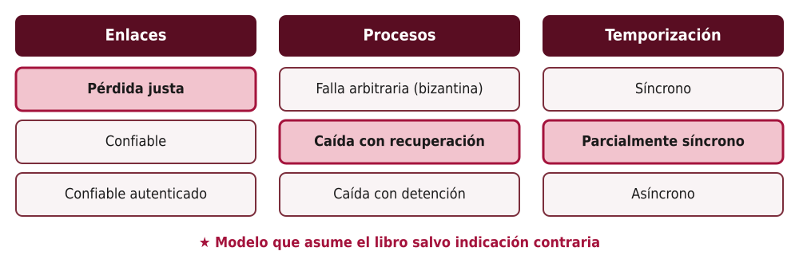

<!--
Un modelo es un conjunto de supuestos sobre enlaces, procesos y tiempo. Enlace confiable se construye sobre uno con pérdida justa con retransmisiones y deduplicación (TCP); el autenticado agrega TLS. Vitillo indica que, salvo aclaración, asume pérdida justa, caída con recuperación y sincronía parcial.
-->

---

# ¿Por qué importan los modelos?

- Un algoritmo es correcto **solo bajo los supuestos** de su modelo
- **Bizantino**: el proceso puede mentir o actuar maliciosamente → algoritmos mucho más costosos (blockchains, aviónica)
- **Caída con recuperación**: pierde lo que estaba en memoria; conserva lo persistido → hay que **persistir** el estado crítico antes de responder
- **Asíncrono puro**: no hay forma de distinguir un proceso lento de uno caído
- **Parcialmente síncrono**: casi siempre hay límites de tiempo… salvo cuando no → los algoritmos deben ser **seguros siempre** y **progresar** cuando el sistema se porta bien

<!--
Énfasis en la sincronía parcial: describe redes reales (congestión, pausas de GC, migraciones de máquinas virtuales). Raft es un ejemplo: nunca viola la seguridad, pero solo garantiza elegir líder cuando la red se estabiliza. Mencionar el resultado FLP como complemento: en un sistema asíncrono puro, ningún algoritmo determinista garantiza consenso si un proceso puede caer.
-->

---

# Detección de fallas (cap. 7): el dilema

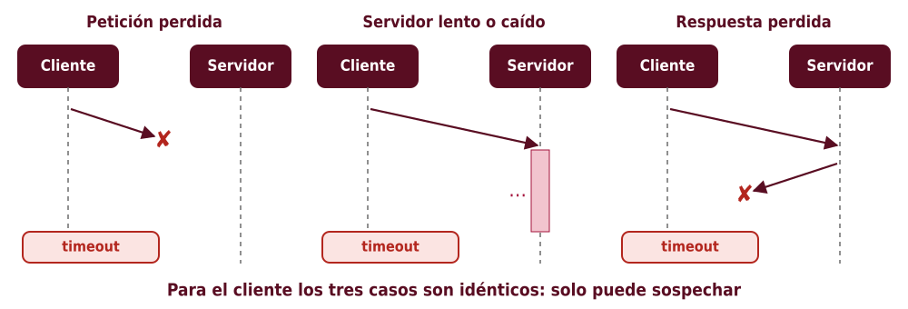

<!--
Esta es la idea central del capítulo 7. Desde el cliente, una petición perdida, un servidor lento, uno caído o una respuesta perdida se ven igual: no llega nada. La única herramienta es el timeout, y con ella solo se puede sospechar.
-->

---

# *Timeouts*, *ping* y *heartbeat*

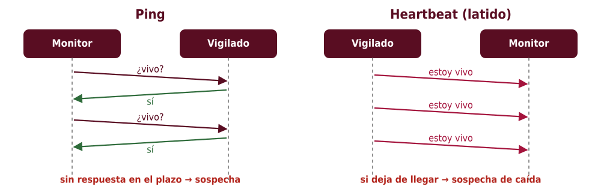

- *Timeout* **corto**: falsos positivos, reintentos de más · **largo**: reacción lenta ante caídas reales
- Un **detector de fallas** solo puede **sospechar**: es imperfecto por naturaleza

<!--
Conectar con los talleres de heartbeat del curso. El ping lo inicia el monitor; el heartbeat lo inicia el proceso vigilado. Vitillo comenta que la detección explícita se justifica cuando los procesos interactúan a menudo; si no, basta con manejar el error cuando una petición falla.
-->

---

# Tiempo (cap. 8): relojes físicos

- Cada máquina tiene un reloj de cuarzo que **deriva**
- **NTP** lo sincroniza estimando la latencia de red, pero con **error** y posibles **saltos** (atrás o adelante)
- ⇒ No usar el **reloj de pared** para ordenar eventos entre máquinas ni para medir intervalos
- Para medir duraciones: **reloj monótono** (nunca retrocede)

```python
import time
t0 = time.monotonic()          # ✔ medir duraciones
hacer_trabajo()
print(time.monotonic() - t0)
time.time()                    # ✘ puede saltar si NTP ajusta el reloj
```

<!--
Ejemplo clásico de error: calcular la duración de una petición con time.time() y obtener un valor negativo porque NTP atrasó el reloj. El monótono solo tiene sentido dentro de una misma máquina: no sirve para comparar eventos entre nodos.
-->

---

# La relación *sucedió-antes* (→)

a → b si:
1. a y b ocurren en el **mismo proceso** y a ocurre antes que b, o
2. a es el **envío** de un mensaje y b su **recepción**, o
3. existe c tal que a → c y c → b (**transitividad**)

Si ni a → b ni b → a, los eventos son **concurrentes** (a ∥ b).

> No importa *cuándo* ocurrió algo, sino **qué pudo haber influido en qué**.

<!--
Definición de Lamport (1978). Concurrente no significa "al mismo tiempo" sino "sin relación causal posible": ninguno pudo influir en el otro.
-->

---

# Relojes de Lamport

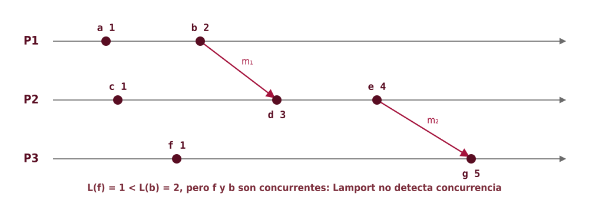

- Incrementar antes de cada evento · enviar el valor · al recibir: `max(local, recibido) + 1`
- a → b ⇒ L(a) < L(b), **pero no al revés** · desempate por id de proceso → **orden total**

<!--
Recorrer el diagrama calculando cada valor. d = max(1, 2) + 1 = 3; g = max(1, 4) + 1 = 5. Mostrar que f (1) y b (2) cumplen L(f) < L(b) sin que f haya influido en b. El orden total resultante es útil (por ejemplo, para exclusión mutua), aunque no refleje la causalidad completa.
-->

---

# Relojes vectoriales

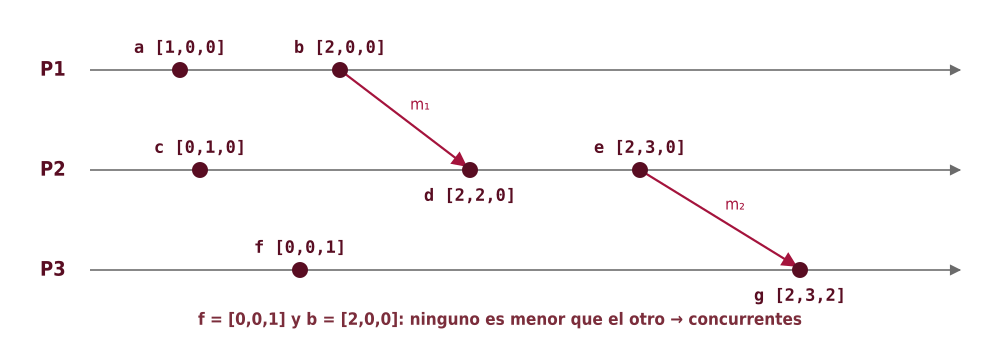

- Un contador **por proceso** · al recibir: máximo componente a componente y luego incrementar el propio
- V(a) < V(b) **si y solo si** a → b · si ninguno es menor → **concurrentes**

<!--
d = max([0,1,0], [2,0,0]) = [2,1,0], luego incrementa la propia entrada → [2,2,0]. g = max([0,0,1],[2,3,0]) = [2,3,1] → [2,3,2]. V(a) ≤ V(b) componente a componente y distintos. Se usan en almacenes como Dynamo para detectar escrituras concurrentes (conflictos).
-->

---

# Lamport frente a vectorial

| | Lamport | Vectorial |
|---|---|---|
| Tamaño | Un entero | Un entero **por proceso** |
| a → b ⇒ | L(a) < L(b) | V(a) < V(b) |
| L(a) < L(b) ⇒ a → b | **No** | Sí (V(a) < V(b) ⇔ a → b) |
| Detecta concurrencia | No | **Sí** |
| Uso típico | Orden total, marcas de versión | Detección de conflictos entre réplicas |

<!--
Tabla de síntesis. El costo de los relojes vectoriales crece con el número de procesos; hay variantes (versionado por réplica en lugar de por cliente) para acotarlo.
-->

---

<!-- _class: seccion -->

# 2. Líder y replicación

Elección de líder · Replicación · Consistencia (caps. 9–10)

<!--
Segundo bloque: el enfoque con coordinador.
-->

---

# Elección de líder (cap. 9)

- Muchas tareas necesitan **un solo** coordinador: aceptar escrituras, asignar trabajo, tomar un recurso exclusivo
- Propiedades requeridas:
  - **Seguridad** (*safety*): **como máximo un líder** a la vez — "nunca pasa algo malo"
  - **Vivacidad** (*liveness*): **eventualmente** hay un líder — "algo bueno termina pasando"
- Vitillo usa como ejemplo el algoritmo de elección de **Raft**

<!--
Distinción clásica entre seguridad y vivacidad. En sincronía parcial, los algoritmos sacrifican vivacidad temporalmente (puede no haber líder durante un rato) pero nunca seguridad.
-->

---

# Raft: estados y transiciones

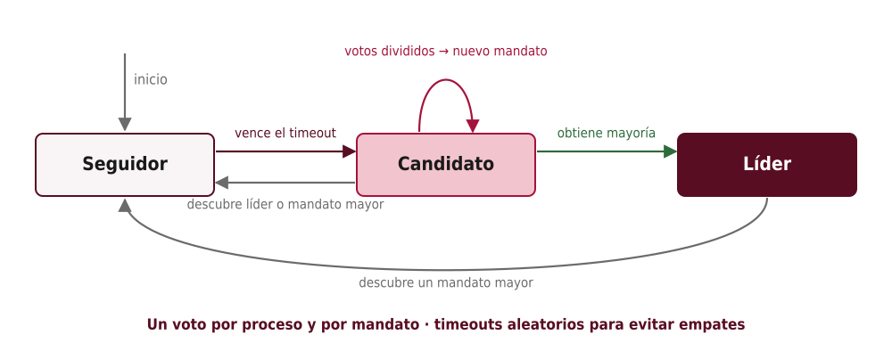

<!--
El tiempo se divide en mandatos (terms). Cada proceso empieza como seguidor. Si no recibe heartbeats del líder durante el timeout de elección, se vuelve candidato, incrementa el mandato, vota por sí mismo y pide votos. Gana con mayoría. Si descubre un líder del mandato actual o un mandato mayor, vuelve a seguidor.
-->

---

# Raft: por qué funciona

- **Mandatos** crecientes: cada mensaje lleva el mandato; un mandato mayor "gana"
- **Un voto por mandato** por proceso + **mayoría** ⇒ dos candidatos no pueden ganar el mismo mandato (dos mayorías siempre se solapan)
- **Timeouts aleatorios** (p. ej., 150–300 ms) ⇒ poco probable que varios candidatos empiecen a la vez → evita empates repetidos
- El líder envía ***heartbeats*** para mantener su autoridad

> Seguridad por **mayorías**; vivacidad por **aleatoriedad** y sincronía parcial.

<!--
El argumento del solapamiento de mayorías es el mismo que reaparece en la replicación y en los quórums. Si dos candidatos obtienen cada uno la mitad de los votos, nadie gana y se repite con mandato nuevo.
-->

---

# En la práctica: arrendamientos

- Rara vez se implementa la elección desde cero: se usa un **almacén linealizable** (etcd, ZooKeeper, DynamoDB)
- **Arrendamiento** (*lease*): una clave con **TTL**
  - se adquiere con una operación atómica (**compare-and-swap**): "créala solo si no existe"
  - el líder la **renueva** periódicamente; si cae, expira y otro la toma

```text
CAS(clave="lider", esperado=None, nuevo="nodo-3", ttl=10s)  → ok
...cada 3 s: renovar(clave="lider", dueño="nodo-3")
```

<!--
Este es el patrón más común en producción. etcd ofrece leases y elecciones como primitiva; Kubernetes lo usa para elegir el controlador activo. El problema: ¿qué pasa si el líder cree que todavía tiene el arrendamiento?
-->

---

# Fichas de cercado (*fencing tokens*)

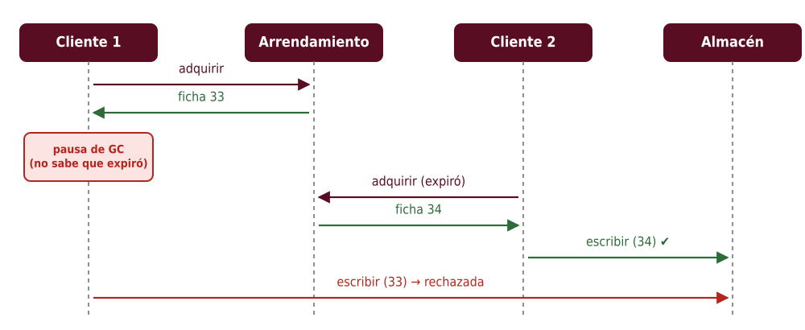

<!--
Escenario de Vitillo: el cliente 1 adquiere el arrendamiento y sufre una pausa larga (GC, máquina virtual congelada). Su arrendamiento expira y el cliente 2 lo adquiere. Al despertar, el cliente 1 cree seguir siendo líder. Solución: cada adquisición devuelve un número creciente (versión) y el recurso rechaza escrituras con un número menor al último visto.
-->

---

# El líder: ¿solución o problema?

- Es un **punto único de falla**: mientras se elige otro, el sistema no avanza
- Es un **cuello de botella**: todo pasa por él
- Recomendaciones del libro:
  - que el líder haga el **menor trabajo** posible
  - usar **fichas de cercado** si el recurso compartido lo permite
  - si se puede, **evitar** necesitar un líder (cap. 11)

<!--
Ejemplo: en lugar de un líder que procesa todas las tareas, un líder que solo asigna particiones de trabajo a los demás. Puente hacia la replicación con Raft y luego hacia los enfoques sin líder.
-->

---

# Replicación de máquinas de estado (cap. 10)

- Si todas las réplicas parten del **mismo estado** y aplican las **mismas operaciones en el mismo orden**, llegan al **mismo estado**
- El problema se reduce a mantener un **registro** (*log*) idéntico → **consenso**
- Raft:
  1. El líder agrega la operación a su registro
  2. La envía a los seguidores (`AppendEntries`)
  3. Cuando la **mayoría** la tiene, la **confirma** y la aplica
  4. Responde al cliente; los seguidores aplican en el siguiente mensaje

<!--
Vitillo presenta la replicación como la aplicación central del consenso. El registro es un registro de operaciones: "x ← 5", "transferir 10 de A a B", etc. Las operaciones deben ser deterministas.
-->

---

# El registro replicado de Raft

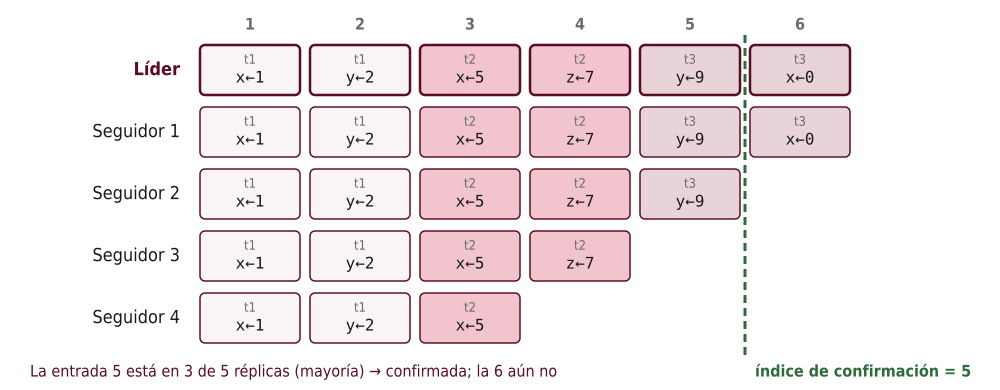

<!--
Cada entrada tiene un mandato (t1, t2, t3) y una operación. La entrada 5 está en el líder, seguidor 1 y seguidor 2: 3 de 5, mayoría → confirmada. La 6 solo está en 2 de 5. Los seguidores atrasados se ponen al día con AppendEntries. Un candidato solo gana si su registro es al menos tan actualizado como el de la mayoría, así nunca se pierde una entrada confirmada.
-->

---

# Tolerancia a fallas: 2f + 1

| Réplicas (N) | Mayoría | Fallas toleradas (f) |
|---|---|---|
| 1 | 1 | 0 |
| 3 | 2 | 1 |
| 4 | 3 | 1 |
| 5 | 3 | 2 |
| 7 | 4 | 3 |

- Con **números pares** no se gana tolerancia: 4 réplicas toleran lo mismo que 3
- Más réplicas ⇒ más tolerancia, pero **más latencia** de escritura

<!--
Por eso clústeres de etcd o ZooKeeper suelen tener 3 o 5 nodos. Con 4 se necesita mayoría de 3, por lo que solo se tolera 1 falla, igual que con 3, pero con más mensajes.
-->

---

# Modelos de consistencia

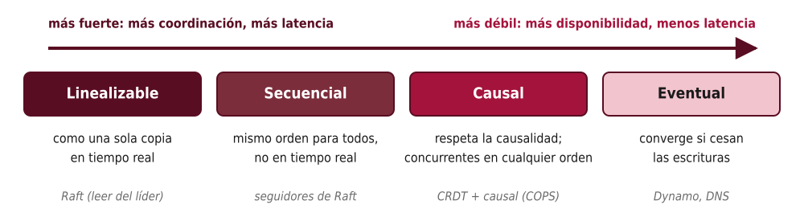

<!--
Un modelo de consistencia es un contrato con el cliente: qué valores puede devolver una lectura. Vitillo los ilustra con Raft: leer del líder (confirmando que lo sigue siendo) da linealizabilidad; leer de un seguidor da consistencia secuencial (va atrasado pero en orden); permitir leer de cualquier réplica sin orden da consistencia eventual. La causal se ve en el cap. 11.
-->

---

# Ejemplos de cada modelo

## Linealizable (fuerte)
- Una vez que una escritura responde, **toda** lectura posterior ve ese valor o uno más nuevo
- Raft: leer del líder, que **confirma** su liderazgo (o usa un arrendamiento)

## Secuencial
- Todos ven el **mismo orden**, pero un lector puede ir **atrasado**: leer de un seguidor

## Eventual
- Se puede leer un valor viejo; si cesan las escrituras, las réplicas **convergen**
- Fácil de implementar, difícil de programar encima: ¿qué pasa si el usuario no ve su propia escritura?

<!--
Para el ejemplo eventual: un usuario actualiza su foto de perfil, recarga la página, la petición cae en otra réplica y ve la foto vieja. Hay garantías intermedias (leer las propias escrituras) que el libro no detalla pero vale la pena mencionar.
-->

---

# Teorema CAP

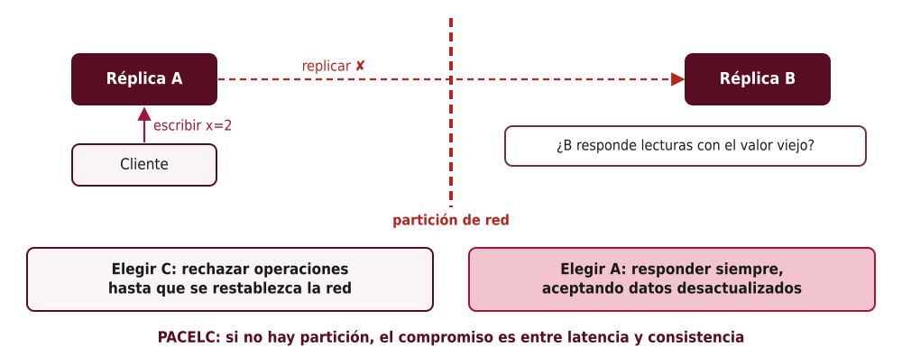

<!--
CAP: ante una partición, un sistema no puede ser a la vez consistente (linealizable) y disponible (toda petición a un nodo sano recibe respuesta). Las particiones no son opcionales en sistemas reales: la elección real es qué sacrificar cuando ocurren.
-->

---

# PACELC: el compromiso cotidiano

- CAP solo habla del caso de **partición**, que es **raro**
- PACELC: si hay **P**artición → **A** o **C**; **E**n otro caso → **L**atencia o **C**onsistencia
- Consistencia fuerte exige **coordinación** ⇒ más mensajes ⇒ más latencia, **siempre**

| Sistema (ejemplos) | Partición | Normal |
|---|---|---|
| etcd, ZooKeeper, Spanner | C | C |
| Dynamo / Cassandra (configuración típica) | A | L |
| Bases de datos con réplicas de lectura asíncronas | A (lecturas) | L |

<!--
Vitillo destaca que la consistencia fuerte tiene un costo de latencia incluso sin fallas. Los ejemplos de la tabla dependen de la configuración: Cassandra puede configurarse con quórums más estrictos.
-->

---

# Replicación en cadena

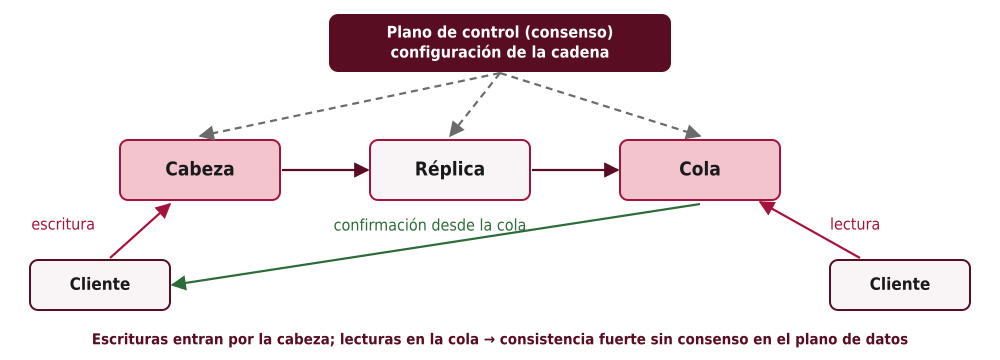

<!--
Alternativa a Raft que separa responsabilidades: el plano de control (que sí usa consenso) decide la composición de la cadena; el plano de datos solo reenvía. Una escritura se confirma cuando llega a la cola; por eso leer de la cola da consistencia fuerte. Si un nodo falla, el plano de control lo saca y reconfigura la cadena.
-->

---

# Cadena frente a Raft

| | Raft | Replicación en cadena |
|---|---|---|
| Escrituras | Al líder; confirma con mayoría | Por la cabeza; confirma la cola |
| Lecturas fuertes | Del líder | De la cola (CRAQ: de cualquiera, consultando a la cola si hay escrituras pendientes) |
| Latencia de escritura | 1 ida y vuelta a la mayoría | Recorre **toda** la cadena |
| Nodo lento | La mayoría lo enmascara | **Frena** toda la cadena |
| Consenso | En el camino de datos | Solo en el **plano de control** |

<!--
Vitillo resalta la idea de separar el plano de control del de datos, que se retoma en la Parte III (cap. 22) y en Azure Storage (cap. 17). CRAQ: Chain Replication with Apportioned Queries.
-->

---

<!-- _class: seccion -->

# 3. Evitar la coordinación

Difusión · CRDT · Quórums · CALM · Causalidad (cap. 11)

<!--
Tercer bloque: ¿se puede replicar sin líder ni consenso?
-->

---

# Protocolos de difusión (*broadcast*)

| Tipo | Garantía | Costo |
|---|---|---|
| ***Best-effort*** | Si el emisor no cae, todos reciben | Bajo; sin garantía si el emisor cae a mitad |
| **Confiable** (ansiosa) | Si un proceso correcto entrega, **todos** entregan | Cada proceso reenvía a todos: O(N²) mensajes |
| **Chismes** (*gossip*) | Confiable con alta probabilidad | Cada uno reenvía a unos pocos al azar |
| **Orden total** | Todos entregan en el **mismo orden** | Requiere **consenso** |

> Difusión de orden total ≡ consenso ≡ replicación de máquinas de estado.

<!--
Vitillo usa la difusión como introducción: si se renuncia al orden total, se renuncia al consenso, y las réplicas pueden recibir actualizaciones en distinto orden. Entonces, ¿cómo convergen? Respuesta: CRDT.
-->

---

# CRDT: datos que convergen solos

- Réplicas que aceptan escrituras **localmente** y se envían su estado
- Se combinan con una operación **merge** que es:
  - **conmutativa**: merge(a, b) = merge(b, a) → no importa el orden
  - **asociativa**: merge(merge(a, b), c) = merge(a, merge(b, c)) → no importa el agrupamiento
  - **idempotente**: merge(a, a) = a → no importan los duplicados
- ⇒ **Consistencia eventual fuerte**: réplicas que recibieron las mismas actualizaciones están en el **mismo estado**

<!--
Matemáticamente, los estados forman un semirretículo y merge es la cota superior mínima. Las tres propiedades hacen que cualquier protocolo de difusión, incluso chismes con duplicados y desorden, sea suficiente.
-->

---

# Ejemplo: contador creciente (G-Counter)

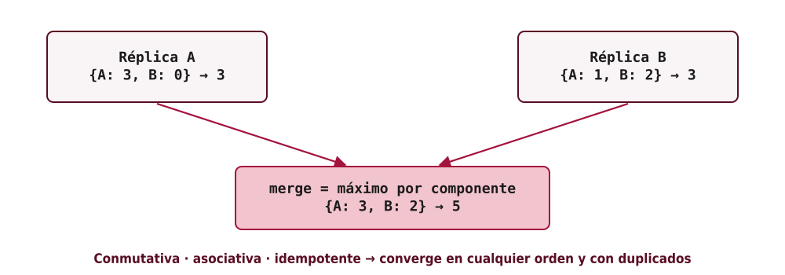

<!--
Cada réplica solo incrementa su propia entrada. El valor es la suma. El merge toma el máximo por réplica. Ejercicio: ¿por qué no funcionaría guardar un solo entero y sumar en el merge? Porque sumar no es idempotente: recibir dos veces el mismo estado contaría doble.
-->

---

# Otros CRDT

- **Registro "último escritor gana"** (LWW): cada valor lleva una marca de tiempo (p. ej., Lamport); el merge conserva la mayor
  - simple, pero **descarta** escrituras concurrentes
- **Registro multivalor** (MV): conserva **todas** las escrituras concurrentes (detectadas con relojes vectoriales) y deja que el cliente resuelva
- **Contadores con decremento** (PN-Counter): dos G-Counter, uno para sumas y otro para restas
- **Conjuntos**: con marcas para distinguir agregar y quitar (p. ej., OR-Set)

> Se pueden **componer**: un mapa de registros, un documento colaborativo…

<!--
Ejemplo cotidiano: carrito de compras con conflictos. LWW puede perder un producto agregado concurrentemente; MV conserva ambas versiones. Editores colaborativos (tipo Google Docs) usan ideas relacionadas.
-->

---

# Almacenes estilo Dynamo: quórums

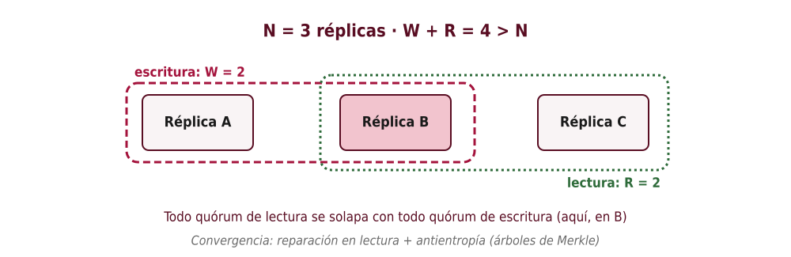

<!--
Sin líder: el cliente (o un coordinador cualquiera) envía la escritura a N réplicas y espera W confirmaciones; para leer consulta R. Si W + R > N, siempre hay al menos una réplica en común con la última escritura. Ajustando W y R se cambia el compromiso: W = 1 da escrituras rápidas; R = 1 lecturas rápidas.
-->

---

# Convergencia sin líder

- **Reparación en lectura** (*read repair*): si una lectura detecta réplicas con versiones viejas, les envía la nueva
- **Antientropía**: proceso de fondo que compara réplicas y sincroniza las diferencias
  - **árboles de Merkle**: hashes jerárquicos para encontrar qué rangos difieren **sin transferir todo**
- Aun con W + R > N, pueden ocurrir **anomalías** (p. ej., escrituras concurrentes, fallas a mitad de escritura): no es linealizable en general

<!--
Vitillo aclara que los quórums no garantizan por sí solos consistencia fuerte; hay casos borde. Ejemplos de este estilo: Amazon Dynamo (artículo de 2007), Cassandra, Riak.
-->

---

# Teorema CALM y consistencia causal

## CALM (*Consistency As Logical Monotonicity*)
- Un problema tiene solución consistente **sin coordinación** ⇔ es **monótono**
- Monótono: agregar información nunca obliga a **retractar** una conclusión
  - ✔ "¿existe un camino entre A y B?" (más aristas no lo invalidan)
  - ✘ "¿*no* existe un camino?" (una arista nueva puede cambiar la respuesta)

## Consistencia causal
- Lo causalmente relacionado se ve **en el mismo orden** en todas partes; lo concurrente, en cualquier orden
- Es el modelo **más fuerte** compatible con **disponibilidad** ante particiones (ej.: COPS)

<!--
CALM da un criterio para saber cuándo se puede evitar la coordinación: si la lógica es monótona. Ejemplo de causalidad: una publicación y su comentario; nadie debería ver el comentario sin la publicación. COPS implementa causalidad con dependencias explícitas.
-->

---

<!-- _class: seccion -->

# 4. Transacciones

ACID · Aislamiento · 2PC · *Outbox* · Sagas (caps. 12–13)

<!--
Cuarto bloque: cambios atómicos sobre varios datos y varios nodos.
-->

---

# ACID (cap. 12)

| Propiedad | Significado |
|---|---|
| **Atomicidad** | Todas las operaciones se aplican o ninguna |
| **Consistencia** | Se preservan las invariantes de la aplicación (p. ej., saldo ≥ 0) |
| **Aislamiento** | Transacciones concurrentes no ven estados intermedios ajenos |
| **Durabilidad** | Lo confirmado sobrevive a fallas (persistido / replicado) |

> La "C" de ACID no es la "C" de CAP: aquí es responsabilidad compartida con la **aplicación**.

<!--
Vitillo menciona que la consistencia de ACID depende de que la aplicación defina transacciones correctas; las otras tres son garantías del sistema. Distinguir explícitamente de la consistencia de CAP (linealizabilidad).
-->

---

<!-- _class: denso -->

# Aislamiento: anomalías y niveles

| Anomalía | Ejemplo |
|---|---|
| **Escritura sucia** | T₂ sobrescribe un valor que T₁ escribió y no ha confirmado |
| **Lectura sucia** | T₂ lee un valor de T₁ que luego se aborta |
| **Lectura no repetible** | T₁ lee x dos veces y obtiene valores distintos |
| **Lectura fantasma** | Una consulta por rango devuelve filas nuevas al repetirse |

| Nivel | Evita |
|---|---|
| Lectura no confirmada | escrituras sucias |
| Lectura confirmada | + lecturas sucias |
| Lectura repetible | + lecturas no repetibles |
| **Serializable** | + fantasmas: equivale a **alguna** ejecución en serie |
| **Serializabilidad estricta** | serializable **+** linealizable (respeta el tiempo real) |

<!--
Niveles más débiles dan más concurrencia y rendimiento, a costa de anomalías. Muchas bases de datos tienen por defecto lectura confirmada (PostgreSQL) o lectura repetible (MySQL InnoDB), no serializable.
-->

---

# Control de concurrencia

## Pesimista: bloqueo en dos fases (2PL)
- **Expansión**: se adquieren bloqueos (lectura compartidos, escritura exclusivos) · **Contracción**: se liberan
- Garantiza serializabilidad · riesgo de **interbloqueos** → detección y aborto

## Optimista (OCC)
- Ejecutar sin bloquear sobre una copia; al confirmar, **validar** que nadie modificó lo leído; si sí, **reintentar**
- Conviene con **pocos conflictos**

## Multiversión (MVCC)
- Se guardan varias versiones; las lecturas usan una **instantánea** consistente y **no bloquean** a las escrituras (*snapshot isolation*)

<!--
Analogía: 2PL es reservar la sala antes de usarla; OCC es entrar y, si otro la usó, volver a empezar. MVCC es la base de PostgreSQL y de muchos sistemas distribuidos (Spanner usa MVCC con marcas de TrueTime).
-->

---

# Atomicidad distribuida: 2PC

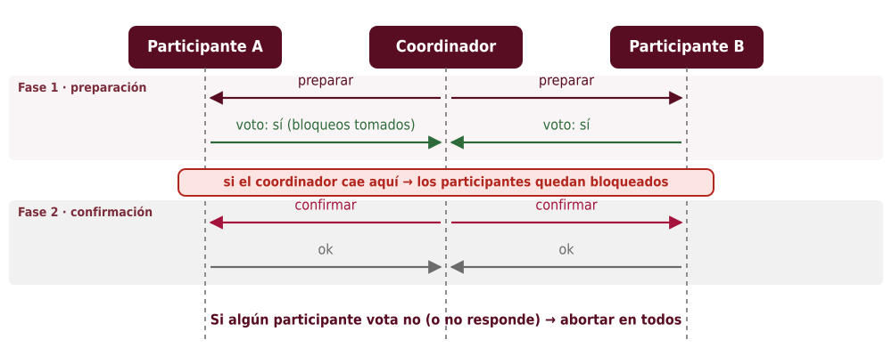

<!--
En un solo nodo, la atomicidad se logra con un registro de escritura anticipada (WAL). Entre nodos, 2PC: el coordinador pide prepararse; cada participante persiste su voto y retiene bloqueos; si todos dicen sí, se confirma. Una vez que un participante votó sí, ya no puede decidir solo: debe esperar al coordinador.
-->

---

# Problemas de 2PC y NewSQL

- **Bloqueante**: si el coordinador cae tras la fase 1, los participantes esperan con **bloqueos tomados**
- **Lento**: varias idas y vueltas y escrituras a disco
- Requiere que **todos** estén disponibles: la disponibilidad empeora con cada participante

## NewSQL: Spanner
- Cada partición se **replica con Paxos** → participantes y coordinador son **tolerantes a fallas**
- 2PC entre particiones + **MVCC**
- **TrueTime**: relojes (GPS y atómicos) con **incertidumbre acotada** → marcas de tiempo globales → **serializabilidad estricta**

<!--
La clave de Spanner: 2PC sigue siendo bloqueante, pero el coordinador ya no es un único proceso sino un grupo replicado, por lo que no "desaparece". TrueTime expone un intervalo [antes, después]; Spanner espera a que pase la incertidumbre antes de confirmar (commit wait).
-->

---

# Transacciones asíncronas (cap. 13): *outbox*

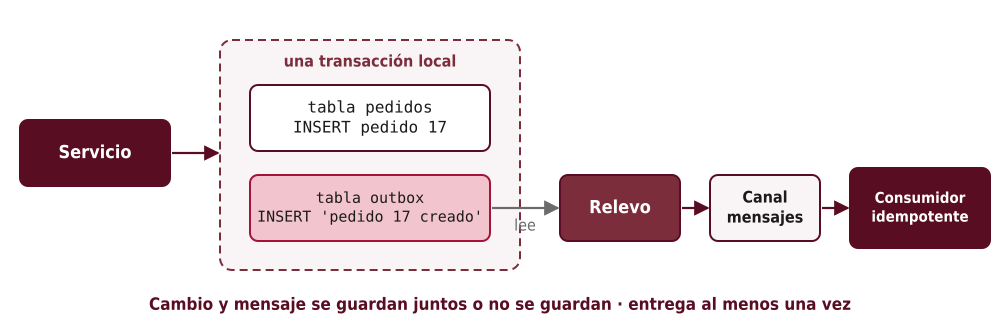

<!--
Problema: el servicio debe guardar un pedido y avisar a otro servicio. Si escribe en la base y luego publica, puede caer entre ambos pasos. Si publica primero, puede publicar algo que nunca se guardó. Solución: escribir el mensaje en una tabla de la misma base, en la misma transacción. Un relevo lo publica después; como puede publicarlo más de una vez, el consumidor debe ser idempotente.
-->

---

# Sagas

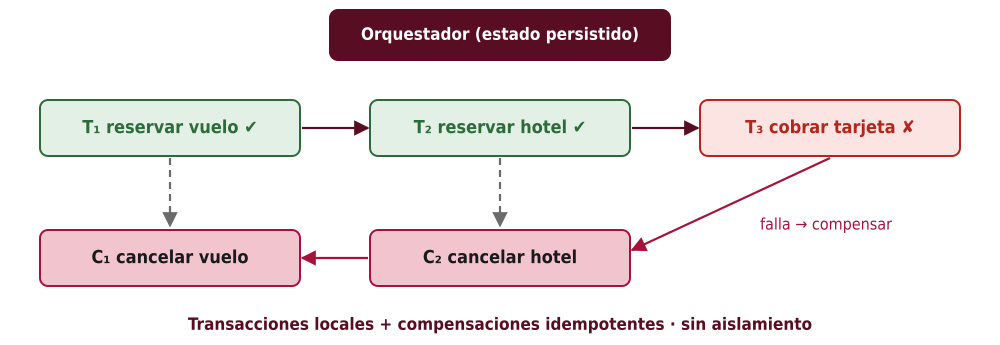

<!--
Ejemplo clásico de Vitillo: reservar un viaje (vuelo + hotel). Cada paso es una transacción local en un servicio distinto. Si un paso falla, se ejecutan las compensaciones de los pasos anteriores en orden inverso. Compensar no es "deshacer" literalmente: es una acción semántica (cancelar una reserva, reembolsar).
-->

---

# Sagas en la práctica

- Un **orquestador** ejecuta los pasos y **persiste** el estado de la saga → puede continuar tras una caída
- Comunicación por **mensajes** (al menos una entrega) ⇒ pasos y compensaciones **idempotentes**
- **Sin aislamiento**: otros pueden ver estados intermedios (vuelo reservado sin hotel)
  - mitigación: **bloqueos semánticos** (marcar "pendiente"), diseñar operaciones conmutativas
- Herramientas de flujo de trabajo (p. ej., AWS Step Functions, Temporal) implementan el orquestador

> 2PC: atomicidad + aislamiento, pero bloqueante · Saga: disponible y desacoplada, pero **sin aislamiento**

<!--
La alternativa al orquestador es la coreografía (cada servicio reacciona a eventos del anterior), que el libro no desarrolla. Preguntar al grupo: ¿qué ve un usuario que consulta su viaje durante la saga?
-->

---

# Ideas clave de la Parte II

1. Los algoritmos son correctos **bajo un modelo**: pérdida justa, caída con recuperación, sincronía parcial
2. Las fallas solo se pueden **sospechar** con *timeouts*
3. Sin reloj global: **Lamport** da orden total; **vectoriales** detectan concurrencia
4. **Raft**: mandatos + mayorías para un líder seguro; **fichas de cercado** contra líderes obsoletos
5. **Replicación**: consenso para consistencia fuerte; **CAP/PACELC** marcan el costo
6. **Sin coordinación**: CRDT, quórums, CALM, consistencia causal
7. **Transacciones**: 2PL/OCC/MVCC, **2PC** (bloqueante), Spanner; asíncronas con **outbox** y **sagas**

<!--
Repaso de lo evaluable en el parcial.
-->

---

# Lecturas y referencias

- R. Vitillo, *Understanding Distributed Systems*, 2.ª ed., caps. 6–13
- L. Lamport, "Time, Clocks, and the Ordering of Events in a Distributed System", 1978
- D. Ongaro y J. Ousterhout, "In Search of an Understandable Consensus Algorithm (Raft)", 2014 — visualización: raft.github.io
- G. DeCandia *et al.*, "Dynamo: Amazon's Highly Available Key-value Store", 2007
- J. Corbett *et al.*, "Spanner: Google's Globally-Distributed Database", 2012
- H. Garcia-Molina y K. Salem, "Sagas", 1987

**Siguiente:** Parte III — Escalabilidad

<!--
La visualización de raft.github.io es muy recomendable para clase: permite tumbar nodos y ver elecciones en vivo.
-->

---

<!-- _class: portada -->
<!-- _paginate: false -->

# ¿Preguntas?

## Parte II · Coordinación

Sistemas Distribuidos
Universidad Industrial de Santander

<!--
Espacio para preguntas.
-->
