<!-- _class: portada -->
<!-- _paginate: false -->

# Parte III · Escalabilidad

## Caché, CDN, particionamiento, balanceo, microservicios y mensajería

Sistemas Distribuidos
Basado en R. Vitillo, *Understanding Distributed Systems*, capítulos 14 a 23
Universidad Industrial de Santander

<!--
Bienvenida. La Parte III es la más práctica del libro: diez capítulos con las técnicas que usan los sistemas reales para crecer. Se recorren en cuatro bloques.
-->

---

# Agenda

1. **Patrones de escalabilidad**
2. **Acercar los datos al cliente** — caché HTTP (cap. 14) y CDN (cap. 15)
3. **Particionar y almacenar** — particionamiento (cap. 16), archivos (cap. 17), datos (cap. 19)
4. **Repartir la carga** — balanceo (cap. 18) y caché (cap. 20)
5. **Descomponer** — microservicios (cap. 21), planos de control y datos (cap. 22), mensajería (cap. 23)

<!--
El orden de los bloques no sigue estrictamente la numeración: el cap. 19 (almacenamiento de datos) se agrupa con particionamiento porque usa las mismas ideas.
-->

---

# ¿Qué significa escalar?

- Un sistema es **escalable** si atiende **más carga** agregando **recursos**, sin rediseñarse
- Carga: peticiones por segundo, usuarios concurrentes, volumen de datos…
- **Vertical** (*scale up*): máquina más grande → simple, pero con **techo** y costo creciente
- **Horizontal** (*scale out*): **más máquinas** → sin techo teórico, pero exige **coordinación**

> La Parte III trata del escalado **horizontal**, apoyándose en lo visto en las Partes I y II.

<!--
Ejemplo: una base de datos en una sola máquina puede crecer hasta cierto número de núcleos y memoria; más allá hay que repartir. Lo distribuido introduce los problemas de la Parte II (consistencia, fallas parciales).
-->

---

# Tres patrones

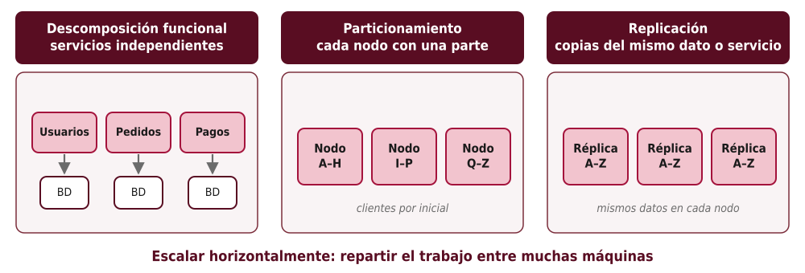

<!--
Vitillo organiza toda la parte con estos tres patrones y los aplica a una aplicación de ejemplo (Cruder) que va creciendo: primero un solo servidor, luego caché y CDN para lo estático, balanceo con varias réplicas sin estado, base de datos replicada y particionada, y finalmente descomposición en servicios. Este esquema se conoce también como el "cubo de escalabilidad".
-->

---

# Cómo crece una aplicación (estilo *Cruder*)

| Problema | Patrón | Técnica | Cap. |
|---|---|---|---|
| Los estáticos saturan el servidor | Replicación | Caché HTTP, CDN | 14–15 |
| Un servidor no basta | Replicación | Réplicas sin estado + balanceador | 18 |
| La base de datos no da abasto en lecturas | Replicación | Réplicas de lectura, caché | 19–20 |
| Los datos no caben en un nodo | Particionamiento | *Sharding*, NoSQL, *blobs* | 16, 17, 19 |
| El código y los equipos crecen | Descomposición | Microservicios, *gateway*, mensajería | 21–23 |

<!--
Tabla guía para toda la sesión. Cada fila es un "dolor" y la técnica que lo alivia. Conviene volver a ella al terminar cada bloque.
-->

---

<!-- _class: seccion -->

# 1. Acercar los datos al cliente

Caché HTTP · CDN (caps. 14–15)

<!--
Primer bloque: replicar contenido y llevarlo cerca del usuario.
-->

---

# Caché HTTP (cap. 14)

- Recursos **estáticos** (imágenes, CSS, JS) cambian poco y se piden mucho
- HTTP permite que el **cliente** los guarde y reutilice
- El servidor controla la vigencia con **`Cache-Control: max-age=<segundos>`**
- Al vencer, la copia queda **obsoleta** (*stale*) y se **revalida** con el servidor
- La caché HTTP es **eventualmente consistente**

<!--
Recordar que HTTP es un protocolo sin estado; las cachés son una de sus grandes ventajas. Se puede mostrar en las herramientas de desarrollo del navegador la columna "Size: (memory cache)" o "(disk cache)".
-->

---

# Expiración y revalidación

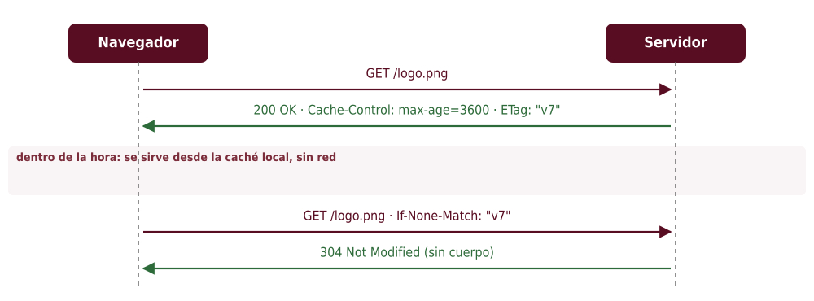

<!--
Primera petición: el servidor devuelve el recurso, su vigencia y una ETag (identificador de versión). Durante la vigencia, no hay red. Después, el cliente pregunta con If-None-Match; si la ETag coincide, el servidor responde 304 sin cuerpo: se ahorra ancho de banda aunque no la ida y vuelta.
-->

---

# Versionar URLs y proxies inversos

```http
GET /static/app.3f9a2c.js
200 OK
Cache-Control: public, max-age=31536000, immutable
```

- Un `max-age` largo impide ver cambios → **cambiar la URL** en cada versión (hash del contenido)
- **Proxy inverso**: servidor frente a la aplicación que cachea respuestas para **todos** los clientes
  - además: terminación TLS, compresión, límite de tasa, balanceo (p. ej., NGINX)

<!--
Las herramientas de empaquetado web (Vite, Webpack) generan nombres con hash automáticamente. El HTML que referencia esos archivos sí debe tener caché corta. El proxy inverso es una caché del lado del servidor: se ubica cerca del origen, no del cliente.
-->

---

# Redes de distribución de contenido (cap. 15)

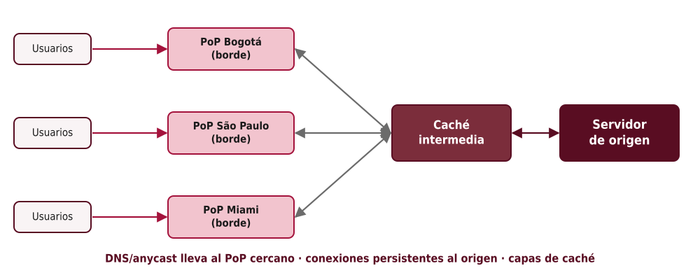

<!--
Una CDN es una red superpuesta de servidores en puntos de presencia (PoP) alrededor del mundo. Funciona como un proxy inverso global con caché. Los PoP de la imagen son ilustrativos.
-->

---

# Cómo funciona una CDN

- **Enrutamiento global**: balanceo por **DNS** (y/o **anycast**) que considera ubicación, salud y carga
- **Rutas optimizadas** y **conexiones persistentes** entre PoP y origen
  - el *handshake* TCP/TLS del cliente se hace con un servidor **cercano** (RTT bajo)
  - ⇒ mejora la latencia **incluso para contenido no cacheable**
- **Caché en capas**: borde → caché intermedia (protege al origen) → origen
- Dentro de un PoP, la caché se **particiona** entre servidores (*hashing* consistente)

<!--
Conectar con los capítulos 2–4: la CDN reduce RTT para TCP y TLS, y usa DNS para enrutar. Además absorbe picos de tráfico y ataques de denegación de servicio. Ejemplos: Cloudflare, Akamai, CloudFront, Fastly.
-->

---

<!-- _class: seccion -->

# 2. Particionar y almacenar

Particionamiento · Archivos · Datos (caps. 16, 17, 19)

<!--
Segundo bloque: cuando los datos no caben en un nodo.
-->

---

# Particionamiento (cap. 16)

- Dividir los datos en **particiones** (*shards*), cada una atendida por un nodo
- Se necesita un **mapa partición → nodo**
  - guardado en un servicio de coordinación (ZooKeeper, etcd)
  - consultado por un **gateway** o por el cliente para enrutar
- Costos:
  - consultas y **transacciones entre particiones** (2PC, Parte II)
  - **rebalanceo** cuando cambian los nodos o la carga
  - **puntos calientes**

<!--
El particionamiento escala escrituras y volumen, a diferencia de la replicación, que escala lecturas y disponibilidad. En la práctica se combinan: cada partición se replica.
-->

---

# Por rango o por *hash*

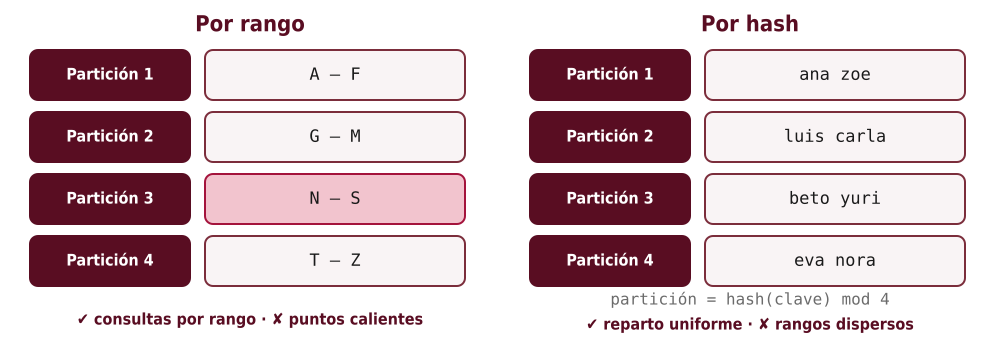

<!--
Por rango: las claves ordenadas se reparten en intervalos contiguos; facilita consultas por rango, pero si las claves son, por ejemplo, fechas, todas las escrituras recientes caen en la última partición (punto caliente; aquí resaltado N–S como ejemplo de partición sobrecargada). Por hash: la función reparte uniformemente, pero claves vecinas quedan dispersas.
-->

---

# El problema de `hash(k) mod N`

| Clave | hash | mod 4 | mod 5 |
|---|---|---|---|
| ana | 1 723 | 3 | 3 |
| luis | 9 102 | 2 | 2 |
| zoe | 4 448 | 0 | 3 |
| beto | 6 731 | 3 | 1 |
| eva | 2 015 | 3 | 0 |

- Al pasar de 4 a 5 nodos, **la mayoría** de claves cambia de nodo → migración masiva
- En general, al pasar de N a N + 1 nodos solo ≈ 1/(N + 1) de las claves conserva su nodo

<!--
Valores de hash inventados para el ejemplo. Pedir que verifiquen los módulos. Tres de cinco claves se mueven. Una clave conserva su nodo solo si hash mod N coincide con hash mod (N+1), lo que ocurre para aproximadamente 1/(N+1) de las claves: con 4 → 5 nodos, se queda cerca del 20 % y se mueve el 80 %. Esto motiva el hashing consistente.
-->

---

# *Hashing* consistente

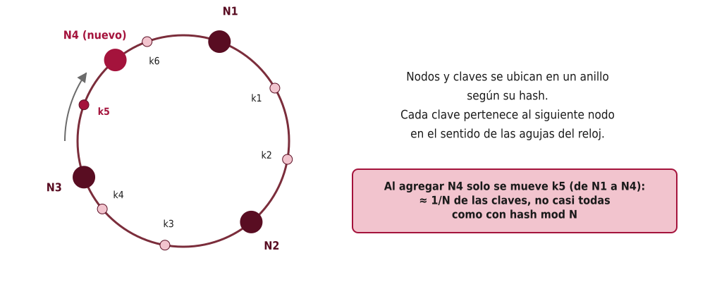

<!--
Nodos y claves comparten el espacio de hash, visto como un anillo. Cada clave pertenece al primer nodo que se encuentra avanzando en el anillo. Al agregar N4, solo las claves entre N3 y N4 cambian de dueño. En la práctica se usan nodos virtuales (cada nodo físico ocupa varias posiciones) para equilibrar la carga. Lo usan Dynamo, Cassandra, las CDN y las cachés distribuidas.
-->

---

# Rebalanceo

## Particiones estáticas
- Crear desde el inicio **muchas más particiones que nodos** (p. ej., 1 000 particiones para 10 nodos)
- Al agregar un nodo, se le **mueven particiones completas**
- Simple, pero el número de particiones queda fijo

## Particiones dinámicas
- **Dividir** una partición cuando crece demasiado; **fusionar** las pequeñas
- Se adapta a datos y carga reales (natural en particionamiento por rango)

<!--
Vitillo presenta ambas estrategias. La dinámica es la que usan, por ejemplo, HBase o Bigtable (división de rangos). La estática es común con hash. En cualquier caso, mover datos consume red y recursos: conviene limitarlo.
-->

---

# Almacenamiento de archivos (cap. 17)

- Archivos grandes (imágenes, video, respaldos) → **almacén de objetos / *blobs*** (Amazon S3, Azure Blob Storage, Google Cloud Storage)
- No en la base de datos: esta guarda solo la **referencia** (URL o clave del objeto)
- Interfaz simple: `PUT`, `GET`, `DELETE` por clave; enorme durabilidad y escala

> Vitillo usa la arquitectura de **Azure Storage** como caso de estudio: reúne replicación en cadena, particionamiento por rango, planos de control y DNS.

<!--
El caso de estudio sirve para ver cómo las piezas teóricas se combinan en un sistema real. El artículo original es "Windows Azure Storage: A Highly Available Cloud Storage Service with Strong Consistency" (SOSP 2011).
-->

---

# Arquitectura de Azure Storage

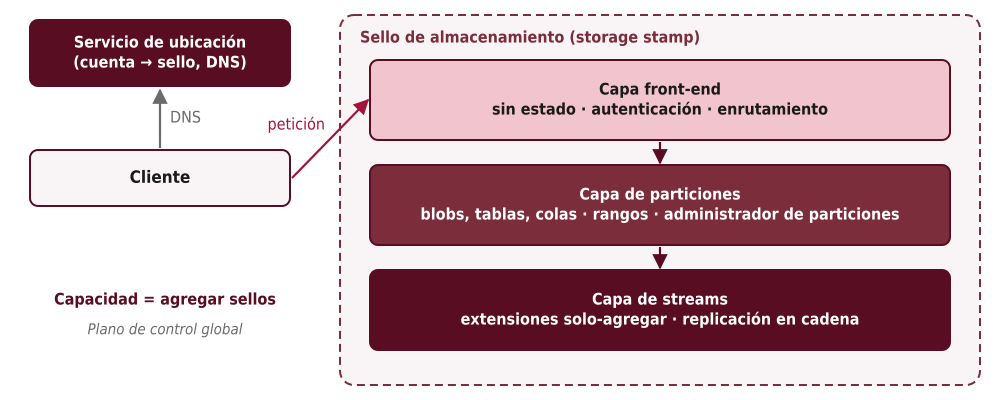

<!--
Recorrer de afuera hacia adentro. El servicio de ubicación asigna cada cuenta a un sello y actualiza el DNS. En el sello, el front-end autentica y enruta; la capa de particiones implementa blobs, tablas y colas sobre rangos de claves; la capa de streams guarda los datos en extensiones de solo agregar replicadas en cadena.
-->

---

# Azure Storage: conceptos reutilizados

| Concepto (parte del libro) | Dónde aparece |
|---|---|
| DNS (Parte I) | El servicio de ubicación enruta cuentas a sellos |
| Replicación en cadena (Parte II) | Extensiones replicadas en la capa de *streams* |
| Plano de control con consenso (Parte II / cap. 22) | Administradores de particiones y de *streams* |
| Particionamiento por rango (cap. 16) | Capa de particiones; divide rangos calientes |
| Servicio sin estado + balanceo (cap. 18) | Capa de *front-end* |
| Escalar agregando unidades | Nuevos sellos |

> Resultado: almacenamiento **fuertemente consistente**, disponible y escalable.

<!--
Pedir a los estudiantes que identifiquen cada concepto en el diagrama anterior. Es una buena pregunta de parcial.
-->

---

# Almacenamiento de datos (cap. 19): réplicas de lectura

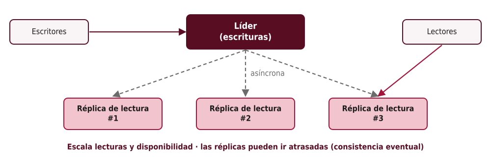

<!--
Primer paso para escalar una base de datos relacional: un líder para escrituras y réplicas para lecturas, normalmente con replicación asíncrona. Conecta con la consistencia eventual del cap. 10: un usuario puede no ver su propia escritura si lee de una réplica atrasada. La replicación síncrona evita perder datos pero agrega latencia.
-->

---

# Relacional frente a NoSQL

| | Relacional (SQL) | NoSQL |
|---|---|---|
| Modelo | Tablas normalizadas | Clave-valor, documentos, columnas anchas |
| Consultas | Flexibles: uniones, agregaciones ad hoc | Limitadas a los **patrones de acceso** diseñados |
| Transacciones | Generales, ACID | Limitadas (p. ej., a una partición o pocas claves) |
| Escalado | Tradicionalmente vertical + réplicas | **Horizontal** nativo (particiones) |
| Diseño | Primero el modelo, luego las consultas | **Primero las consultas**, luego el modelo |

<!--
Vitillo explica que NoSQL sacrifica flexibilidad a cambio de escalabilidad. No es mejor ni peor: depende de los patrones de acceso. Hoy hay bases de datos relacionales distribuidas (NewSQL, cap. 12) que difuminan la frontera.
-->

---

# Ejemplo: DynamoDB

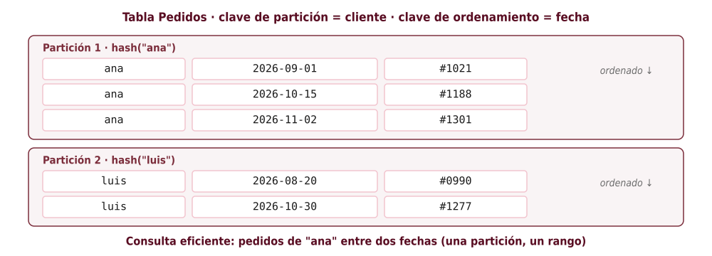

- **Clave de partición** → por *hash* decide la partición
- **Clave de ordenamiento** → orden dentro de la partición (consultas por rango)
- Índices secundarios **locales** (misma partición) y **globales** (otra clave de partición)

<!--
El ejemplo de la tabla Pedidos: consultar los pedidos de un cliente en un rango de fechas toca una sola partición y lee un rango contiguo. Consultar "todos los pedidos de octubre" de todos los clientes no es eficiente sin un índice global.
-->

---

# Diseñar a partir de los patrones de acceso

1. Enumerar las **consultas** que la aplicación necesita
2. Elegir claves de partición y ordenamiento que las resuelvan **sin recorrer toda la tabla**
3. **Desnormalizar**: duplicar datos donde se leen; a veces **una sola tabla** con varias entidades
4. Agregar índices secundarios para los patrones restantes

> En relacional: "¿qué datos tengo?" · En NoSQL: "¿qué preguntas voy a hacer?"

<!--
Ejercicio para clase: dada una aplicación de biblioteca (usuarios, libros, préstamos), proponer claves para "préstamos activos de un usuario" y "historial de un libro". Discutir qué pasa si aparece una consulta nueva no prevista.
-->

---

<!-- _class: seccion -->

# 3. Repartir la carga

Balanceo de carga · Caché (caps. 18 y 20)

<!--
Tercer bloque.
-->

---

# Balanceo de carga en red (cap. 18)

- Para escalar un servicio **sin estado**: varias réplicas detrás de un **balanceador**
- Funciones:
  - **Reparto**: *round-robin*, *hashing* consistente, menos conexiones / menor carga
  - **Descubrimiento de servicios**: registro dinámico de réplicas (etcd, Consul, DNS interno)
  - **Verificación de salud**: retirar réplicas enfermas de la rotación
- El balanceador oculta las réplicas tras **una sola dirección**

<!--
"Sin estado" es clave: si una réplica guarda la sesión del usuario en memoria, el balanceador no puede enviar las peticiones a cualquiera. El estado se lleva a una base de datos o caché externa.
-->

---

# La potencia de dos opciones aleatorias

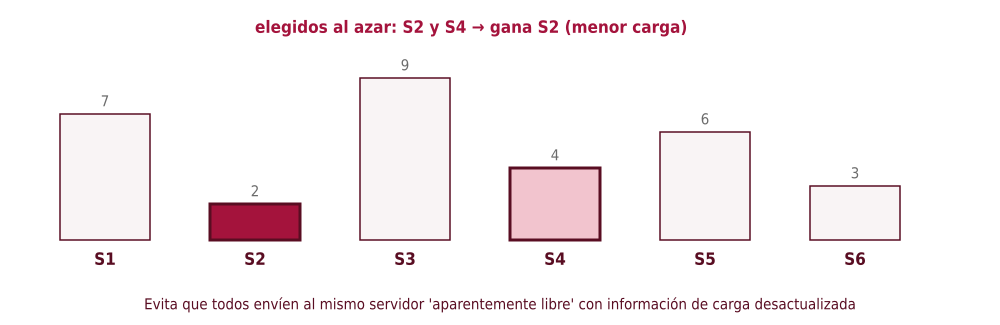

<!--
Vitillo advierte que repartir según la carga reportada puede causar efecto rebaño: todos los balanceadores ven el mismo servidor "libre" y lo saturan, porque la información está desactualizada. Elegir dos al azar y quedarse con el menos cargado da un reparto casi óptimo y robusto.
-->

---

# Salud y balanceo por DNS

## Verificación de salud
- **Pasiva**: el balanceador observa errores y *timeouts* del tráfico real
- **Activa**: consulta periódicamente un endpoint (p. ej., `GET /health`)
- Cuidado: un endpoint de salud que revisa dependencias puede **sacar a todas** las réplicas si una dependencia falla

## Balanceo por DNS
- Varias IP para un nombre: simple, sin componente extra
- Pero **no conoce la salud** y las **cachés con TTL** retrasan los cambios (cap. 4)

<!--
Conectar con los talleres de heartbeat: un health check activo es un ping. El riesgo de los health checks profundos se discute en la Parte IV del libro.
-->

---

# Capa 4 frente a capa 7

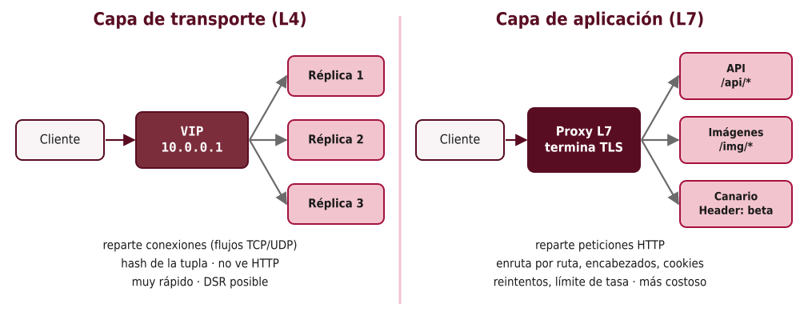

<!--
L4: el balanceador ve paquetes TCP/UDP; asigna cada conexión (flujo) a una réplica con un hash de la tupla de conexión y mantiene el seguimiento. Con retorno directo del servidor (DSR), las respuestas van directo al cliente. L7: el balanceador es un proxy HTTP que termina la conexión y decide por petición.
-->

---

# L4, L7 y *sidecars*

| | L4 (transporte) | L7 (aplicación) |
|---|---|---|
| Unidad | Conexión / flujo | Petición HTTP |
| Ve el contenido | No | Sí (ruta, encabezados, *cookies*) |
| TLS | Pasa cifrado | Puede **terminarlo** |
| Rendimiento | Muy alto | Menor (más trabajo por petición) |
| Funciones extra | Pocas | Reintentos, límite de tasa, despliegues canario |

- L7 como ***sidecar*** junto a cada servicio → **malla de servicios** (Envoy, Istio, Linkerd)
- El balanceador también debe ser **redundante** (varias instancias, *anycast*, activo-pasivo)

<!--
Una arquitectura típica: L4 en el borde (alto volumen) que reparte hacia una flota de L7. Con conexiones HTTP/2 o gRPC de larga duración, un L4 reparte mal porque una sola conexión lleva muchas peticiones: ahí L7 es necesario.
-->

---

# Caché (cap. 20)

- Guardar resultados **costosos** de obtener para servirlos más rápido
- Métrica clave: **tasa de aciertos** (*hit ratio*) — depende de cuánto se repiten los accesos
- Políticas:
  - **Expiración** (TTL): limita cuán viejos pueden ser los datos
  - **Desalojo** al llenarse: p. ej., **LRU** (el usado hace más tiempo)

```python
from functools import lru_cache
@lru_cache(maxsize=1024)          # caché local en proceso, política LRU
def precio(producto_id): return consultar_bd(producto_id)
```

<!--
Una caché solo ayuda si los mismos datos se piden repetidamente. Para datos que cambian constantemente o se consultan una sola vez, no sirve. lru_cache no tiene expiración: ilustra solo el desalojo.
-->

---

# Caché local frente a externa

| | Local (en proceso) | Externa (Redis, Memcached) |
|---|---|---|
| Latencia | Mínima | Una ida y vuelta de red |
| Compartida entre instancias | No → duplicación e inconsistencias | Sí |
| Tras un despliegue | **Fría**: todas las instancias van a la BD | Se conserva |
| Escala | Limitada a la memoria del proceso | Particionada (*hashing* consistente) y replicada |
| Riesgo | Avalancha sobre la BD (*thundering herd*) | **Nueva dependencia** que puede fallar |

<!--
La caché externa es otro sistema distribuido que operar. Si cae, toda la carga que absorbía pasa a la base de datos. Vitillo insiste en que el sistema debe tolerar ese escenario.
-->

---

# Patrones de acceso a la caché

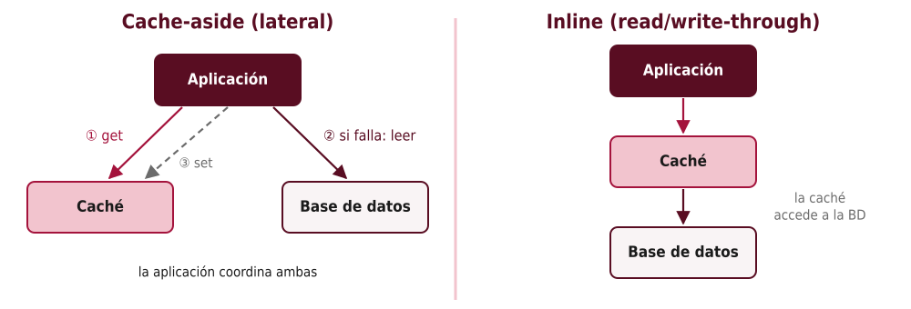

<!--
Cache-aside: la aplicación consulta la caché; si falla, lee de la base de datos y llena la caché. Es el más común con Redis. Inline: la aplicación solo conoce la caché, que lee y escribe en la base de datos (read-through, write-through). Simplifica la aplicación pero exige una caché que entienda la base de datos.
-->

---

# La caché no es una muleta

- Si la base de datos **solo funciona gracias a la caché**, una caché vacía (reinicio, despliegue, falla) la **tumba**
- Mitigaciones:
  - dimensionar la base de datos para un nivel razonable de fallos de caché
  - **calentar** la caché gradualmente; limitar peticiones concurrentes por la misma clave
  - **descartar carga** (*load shedding*) si la base de datos se satura
- Recordar la **consistencia**: la caché puede servir datos **viejos** hasta que expiren o se invaliden

<!--
Vitillo advierte sobre este anti-patrón. Ejemplo: un servicio que tiene 95 % de aciertos; si la caché se vacía, la base de datos recibe 20 veces más carga de golpe. Puente con la Parte IV (resiliencia).
-->

---

<!-- _class: seccion -->

# 4. Descomponer

Microservicios · Planos de control y datos · Mensajería (caps. 21–23)

<!--
Cuarto bloque: descomposición funcional.
-->

---

# Microservicios (cap. 21)

- Dividir la aplicación en **servicios independientes**, cada uno con **su propia base de datos**, comunicados por API
- Beneficios:
  - equipos que **desarrollan, despliegan y escalan** su servicio de forma independiente
  - límites claros de responsabilidad
  - escalar solo lo que lo necesita
- Muchos equipos grandes los adoptan cuando el monolito frena el desarrollo

<!--
El beneficio principal es organizacional: permite que muchos equipos trabajen en paralelo. Relación con la ley de Conway: la arquitectura tiende a reflejar la estructura de comunicación de la organización.
-->

---

# Los costos de los microservicios

- **Proliferación tecnológica**: cada equipo con su lenguaje y sus herramientas
- **Comunicación**: llamadas por red → latencia, fallas parciales, versionado de API
- **Acoplamiento**: límites mal trazados → cambios que tocan varios servicios ("monolito distribuido")
- **Aprovisionamiento**, **pruebas** de extremo a extremo y **operación** más difíciles
- **Consistencia eventual**: sin transacciones compartidas → sagas y *outbox* (Parte II)

> Recomendación del libro: **empezar con un monolito** modular y separar cuando los límites estén claros.

<!--
Pregunta para discutir: ¿tiene sentido usar microservicios en el proyecto de un curso con cuatro integrantes? Normalmente no: los costos superan el beneficio.
-->

---

# API *gateway*

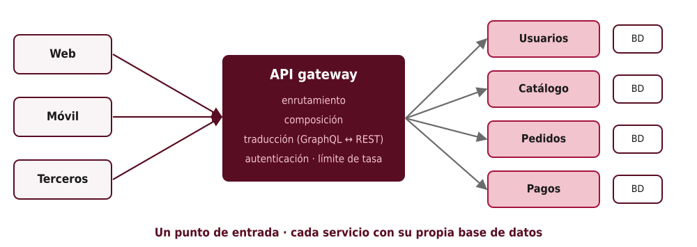

<!--
El gateway es el punto de entrada único para los clientes externos. Oculta la estructura interna: los servicios pueden dividirse o renombrarse sin romper a los clientes.
-->

---

# Funciones del *gateway*

- **Enrutamiento**: `/pedidos/*` → servicio de pedidos
- **Composición**: una petición del cliente → varias internas → una respuesta combinada
- **Traducción**: GraphQL ↔ REST, HTTP ↔ gRPC; versiones de API
- **Funciones transversales**: autenticación y autorización (*tokens* JWT), límite de tasa, caché, registro

**Riesgos:** cuello de botella, punto único de falla, y si acumula lógica de negocio, **acopla** a todos los equipos

<!--
Conectar con el capítulo 5 (APIs) y con el taller del agregador resiliente en FastAPI, que es esencialmente un gateway con composición. Ejemplos: Kong, AWS API Gateway, Envoy.
-->

---

# Planos de control y planos de datos (cap. 22)

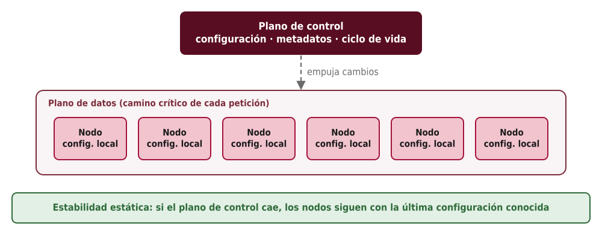

<!--
Plano de datos: procesa cada petición, está en el camino crítico, debe ser rápido y muy disponible. Plano de control: configura, asigna, despliega. Ejemplos: en un balanceador, reenviar paquetes (datos) frente a actualizar la lista de réplicas (control); en Azure Storage, los servidores de extensiones frente al administrador de streams.
-->

---

# Desequilibrio de escala y estabilidad estática

- El plano de datos suele ser **mucho más grande** que el de control
- Si **todos** los nodos de datos piden configuración a la vez (p. ej., tras un reinicio masivo), **saturan** el plano de control
  - mitigaciones: que el control **empuje** cambios, cachés de configuración, límites de tasa, espaciar reintentos
- **Estabilidad estática**: si el plano de control **cae**, el plano de datos **sigue operando** con la última configuración conocida
  - se pierde la capacidad de **cambiar**, no la de **servir**

<!--
Ejemplo: si el servicio que gestiona la creación de máquinas virtuales falla, las máquinas que ya corren deben seguir corriendo. El plano de control suele usar consenso (Parte II) y es más lento: no debe estar en el camino de cada petición.
-->

---

# El plano de control como lazo de control

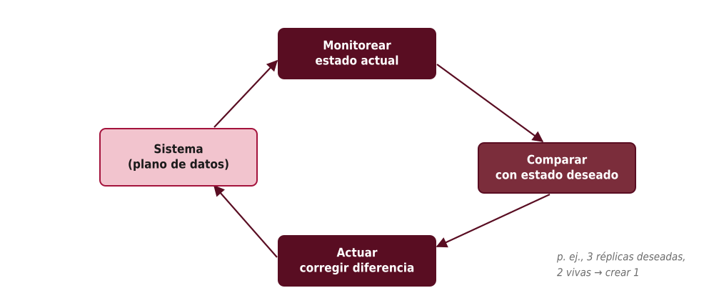

<!--
Vitillo toma la idea de la teoría de control: un lazo cerrado que mide, compara con el objetivo y corrige. Es el patrón de reconciliación de Kubernetes: el usuario declara el estado deseado (3 réplicas) y los controladores trabajan continuamente para alcanzarlo. También el autoescalado.
-->

---

# Mensajería (cap. 23)

- Comunicación **asíncrona** a través de un **canal** (cola o *broker*): SQS, RabbitMQ, Kafka
- Beneficios:
  - **desacopla** emisor y receptor (no necesitan estar disponibles al mismo tiempo)
  - **nivela la carga**: la cola absorbe los picos
  - permite procesar **por lotes** y escalar consumidores
- Patrones: **unidireccional**, **petición-respuesta** (dos canales + id de correlación), **difusión**

<!--
Ejemplo: un servicio de pedidos publica "pedido creado"; el de correos y el de inventario lo procesan cuando pueden. Si el de correos está caído una hora, los mensajes esperan en la cola.
-->

---

# Tipos de canal

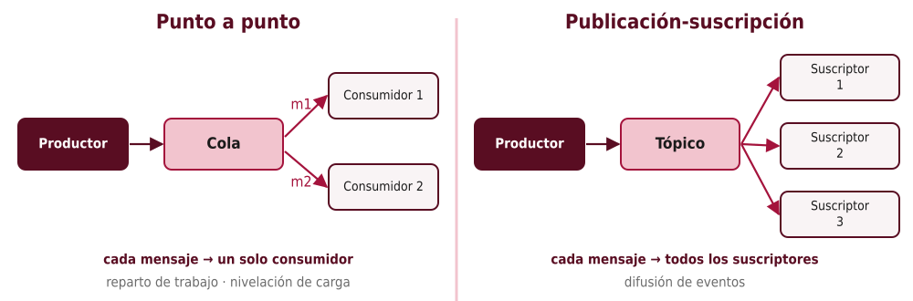

<!--
Punto a punto: los consumidores compiten; cada mensaje lo procesa uno. Publicación-suscripción: cada suscriptor recibe su copia. Kafka combina ambos: tópicos con particiones y grupos de consumidores; el orden se garantiza por partición.
-->

---

# Garantías: ¿exactamente una vez?

- Las garantías **varían** entre implementaciones: orden, entrega, durabilidad
- **Exactamente una vez** no es posible en general (Parte II: no se distingue un consumidor lento de uno caído)
- Lo habitual: **al menos una vez**
  - el consumidor **confirma** (*ack*) tras procesar
  - si no confirma antes del **tiempo de visibilidad**, el mensaje **reaparece**
- ⇒ **efectivamente una vez** = al menos una vez + consumidor **idempotente** (o deduplicación por id)

<!--
Conectar con el patrón outbox y las sagas: todos dependen de consumidores idempotentes. Ejemplo de idempotencia: guardar el id del mensaje procesado en la misma transacción que el efecto, y descartar duplicados.
-->

---

# Fallas y acumulación

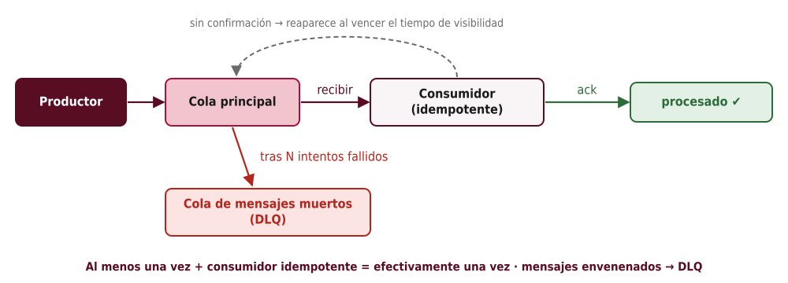

- **Acumulación** (*backlog*): si producen más rápido de lo que se consume, la cola crece → **monitorear** tamaño y antigüedad del mensaje más viejo; escalar consumidores

<!--
Un mensaje envenenado (que siempre falla) se reintentaría eternamente. Tras N intentos se mueve a la cola de mensajes muertos para inspección manual. La antigüedad del mensaje más viejo es una métrica más útil que el tamaño de la cola.
-->

---

# Ideas clave de la Parte III

1. Tres patrones: **descomposición funcional**, **particionamiento**, **replicación**
2. **Caché HTTP** (`Cache-Control`, `ETag`) y **CDN** acercan el contenido y reducen RTT
3. **Particionar** por rango (rangos, puntos calientes) o por *hash* (uniforme); ***hashing* consistente** para rebalancear
4. **Azure Storage** combina DNS, particiones por rango y replicación en cadena
5. **Balanceo** L4/L7, salud y descubrimiento; **potencia de dos opciones**
6. **Caché** local o externa; nunca como muleta
7. **Microservicios** con costos; **gateway**; **planos** de control y datos con estabilidad estática
8. **Mensajería**: al menos una vez + idempotencia; **DLQ** para mensajes envenenados

<!--
Repaso de lo evaluable en el parcial.
-->

---

# Lecturas y referencias

- R. Vitillo, *Understanding Distributed Systems*, 2.ª ed., caps. 14–23
- RFC 9111 — *HTTP Caching*
- D. Karger *et al.*, "Consistent Hashing and Random Trees", 1997
- B. Calder *et al.*, "Windows Azure Storage: A Highly Available Cloud Storage Service with Strong Consistency", SOSP 2011
- M. Mitzenmacher, "The Power of Two Choices in Randomized Load Balancing", 2001
- Documentación de Amazon DynamoDB: *Best practices for designing and architecting*

**Siguiente:** Parte IV — Resiliencia

<!--
Cerrar con el puente a la Parte IV: muchas de las técnicas de escalabilidad (caché, planos, mensajería) introducen nuevos modos de falla que se estudiarán allí.
-->

---

<!-- _class: portada -->
<!-- _paginate: false -->

# ¿Preguntas?

## Parte III · Escalabilidad

Sistemas Distribuidos
Universidad Industrial de Santander

<!--
Espacio para preguntas.
-->
